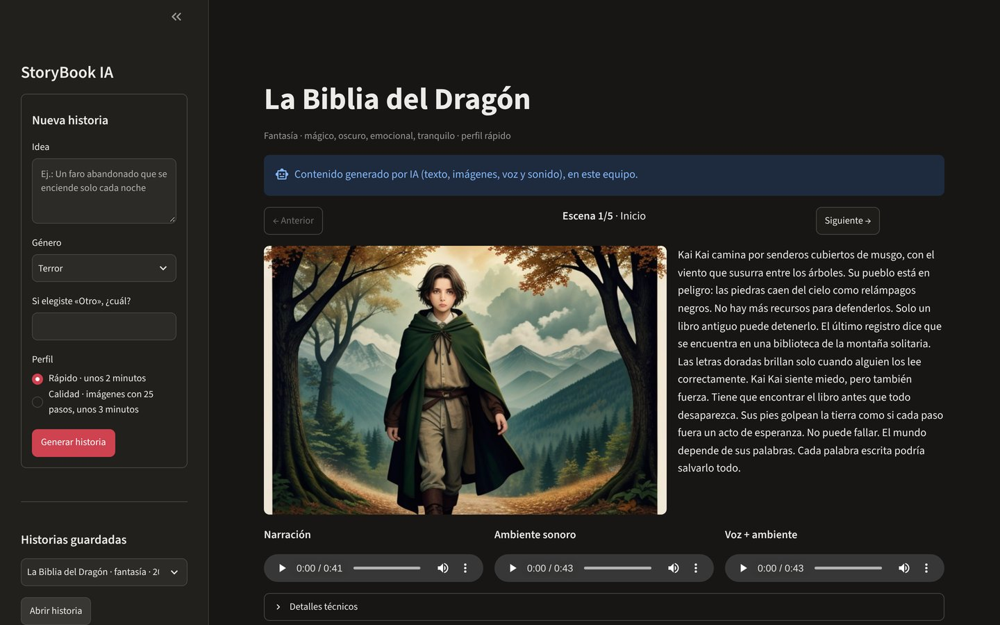
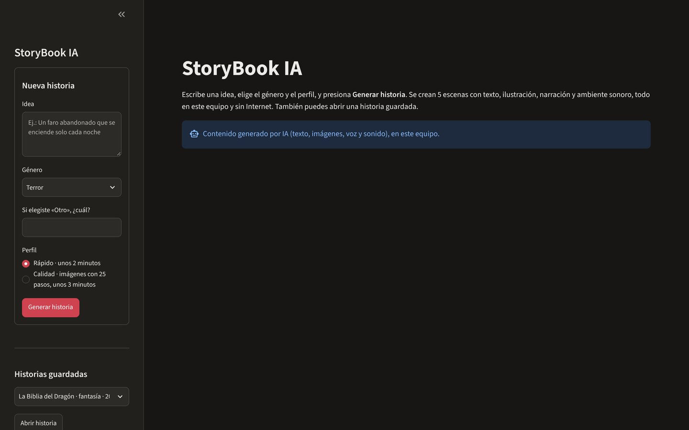
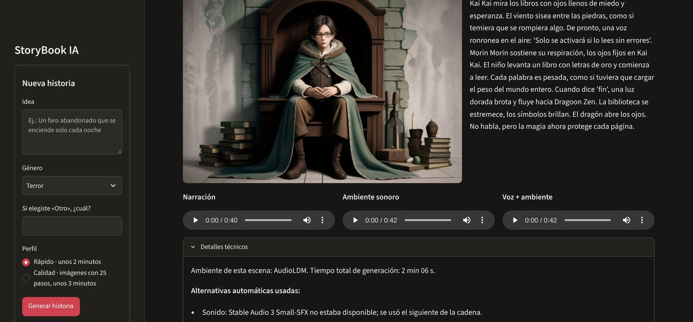
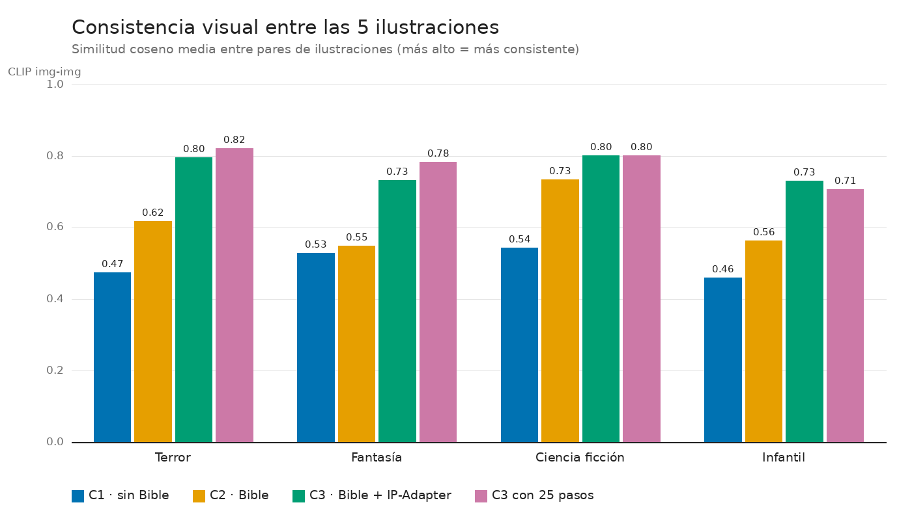

# StoryBook IA

Aplicación local de IA generativa que, a partir de una **idea** y un **género**, genera un cuento
de **exactamente 5 escenas**. Cada escena incluye texto narrativo, ilustración original, narración
con voz sintética en español y ambientación sonora. Todos los modelos se ejecutan en el equipo
local; no se usan APIs de pago ni servicios de inferencia remotos.

Proyecto integrador · Electiva Ingeniería Aplicada – Inteligencia Artificial Generativa ·
Ingeniería de Sistemas · Universidad Santo Tomás, Seccional Tunja · 2026.

> **Estado (11 nov 2026):** aplicación completa y probada en el equipo de referencia: texto,
> imagen, voz, sonido, mezcla, interfaz, verificación sin conexión, historias de ejemplo y
> batería de experimentos. En curso: informe técnico, video y ensayo de la sustentación.

| Documento | Contenido |
|---|---|
| [`docs/arquitectura.md`](docs/arquitectura.md) | Componentes, flujo de datos, uso de la GPU, alternativas automáticas y decisiones de diseño, con diagramas |
| [`docs/informe/analisis_experimentos.md`](docs/informe/analisis_experimentos.md) | Resultados de los experimentos (consistencia visual, tiempos, sonido y LLM) |
| [`MODELS.md`](MODELS.md) | Modelos, revisiones, licencias y mediciones |
| [`docs/PROGRESO.md`](docs/PROGRESO.md) | Tareas y bitácora de cada prueba |

## Requisitos

| | Mínimo | Equipo de referencia (pruebas y sustentación) |
|---|---|---|
| SO | Windows 10/11 x64 | Windows 11 Home x64 (build 26200) |
| GPU | NVIDIA con 4 GB de VRAM (Ampere o superior), driver con CUDA 13.2 | RTX 3050 Laptop 4 GB |
| RAM | 16 GB | 24 GB |
| Disco | 25 GB libres | — |
| Software | [uv](https://docs.astral.sh/uv/), [Ollama](https://ollama.com), Git | — |

Python 3.12 instalado desde python.org (o `winget install Python.Python.3.12`). No se usa el Python que descarga `uv` porque el Control inteligente de aplicaciones de Windows puede bloquearlo. No se requiere ffmpeg.

## Instalación (PowerShell)

```powershell
# 1. Clonar y entrar al proyecto
git clone https://github.com/DiegoAlejandroU/StoryBook-IA.git
cd StoryBook-IA

# 2. Verificar la versión de CUDA que soporta el driver (línea "CUDA Version")
nvidia-smi
#    >= 13.2 -> continuar. 12.x -> actualizar el driver o usar el índice alternativo
#    comentado en pyproject.toml (torch 2.14 + cu126).

# 3. Crear el entorno con el Python 3.12 del sistema e instalar dependencias
#    (incluye PyTorch con CUDA)
uv venv --python-preference only-system --python 3.12
uv sync
uv run python -c "import torch; print(torch.__version__, torch.version.cuda, torch.cuda.is_available())"
#    Debe mostrar una versión de CUDA (no None) y True.

# 4. Configuración local
Copy-Item .env.example .env
#    Editar .env y pegar HF_TOKEN (solo necesario para Stable Audio, licencia gated).

# 5. Optimización de VRAM para Ollama (una sola vez; luego reiniciar Ollama)
[Environment]::SetEnvironmentVariable("OLLAMA_FLASH_ATTENTION", "1", "User")
[Environment]::SetEnvironmentVariable("OLLAMA_KV_CACHE_TYPE", "q8_0", "User")

# 6. Descargar modelos (único paso con Internet). Ollama debe estar abierto.
uv run python scripts/download_models.py

# 7. Diagnóstico del entorno
uv run python scripts/check_env.py
```

Los pesos quedan en `models/` (excluida de git): `models/hf` (caché de Hugging Face) y
`models/piper` (voces). Los modelos de Ollama se guardan en la carpeta de Ollama del usuario.
El registro de repositorios, revisiones y licencias descargadas queda en
`docs/models_registry.json`.

### Licencias "gated"

Los modelos de Stable Audio exigen aceptar la *Stability AI Community License* en la página de
cada modelo, con la misma cuenta del token: `stabilityai/stable-audio-3-small-sfx` y
`stabilityai/stable-audio-open-1.0`. Sin ese paso, la aplicación funciona igual: el sonido se genera con
AudioLDM (`cvssp/audioldm`, no requiere token) y, si tampoco está, con la biblioteca CC0 y la
síntesis procedural.

## Usar la aplicación

Con doble clic en **`StoryBook.cmd`**, en la carpeta del proyecto. Abre Ollama si hace falta,
inicia la app y la muestra en el navegador (http://localhost:8501). Para cerrarla, cierra la
ventana negra.

Equivalente en PowerShell:

```powershell
uv run streamlit run app/streamlit_app.py              # modelos reales (Ollama abierto)
uv run streamlit run app/streamlit_app.py -- --mock    # modo simulado, sin GPU ni Ollama
```

En la app:

1. Escribe una idea, elige el género y el perfil (rápido o calidad) y presiona
   **Generar historia**.
2. Recorre las 5 escenas con **Anterior** y **Siguiente**. Cada escena muestra su
   ilustración, el texto y tres reproductores: narración, ambiente sonoro y mezcla.
3. **Regenerar ilustración y ambiente** crea una imagen y un sonido nuevos para la escena.
4. En **Historias guardadas** se abren las historias anteriores (`outputs/`) y los
   ejemplos (`samples/`).

Cada historia queda en `outputs/<run_id>/` con `story.json`, las imágenes, los audios y
`manifest.json`. El manifest registra modelos, seeds, parámetros, hardware, tiempos,
alternativas usadas y errores.

Para comprobar que nada sale a Internet:

```powershell
uv run python scripts/verify_offline.py          # pipeline simulado
uv run python scripts/verify_offline.py --real   # modelos reales; con el Wi-Fi apagado
```

En la prueba real con el Wi-Fi apagado (tarea 5.4) se generaron 3 historias completas y no
hubo ningún intento de conexión fuera del equipo.

### Historias de ejemplo

`samples/` trae 3 historias completas generadas en el equipo de referencia: "El Faro de
Lucian" (misterio), "La Biblia del Dragón" (fantasía) y "El Camino de los Amigos"
(infantil). Los audios van en OGG, unos 8 MB por historia. Se abren desde
**Historias guardadas** sin GPU ni Ollama, y sirven de plan B en una demo.



| Inicio | Detalles técnicos de una escena |
|---|---|
|  |  |

## Resultados medidos (equipo de referencia)

RTX 3050 Laptop de 4 GB, perfil rápido, batería de 4 historias (una por género). El detalle
está en [`docs/informe/analisis_experimentos.md`](docs/informe/analisis_experimentos.md).

| Medida | Valor |
|---|---|
| Tiempo por historia completa (5 escenas con imagen, voz, ambiente y mezcla) | 124–129 s (mediana 128 s) |
| Texto (Qwen3 4B, por etapas + auditor) | 74–90 s; 9 de 10 Story Bibles válidas en la tarea 1.4 |
| Imágenes (SD 1.5 + LCM 6 pasos + IP-Adapter) | ~27 s por historia; 3,2 GB asignados en la GPU |
| Consistencia visual (CLIP img-img, media) | 0,765 con C3, frente a 0,616 con C2 y 0,501 con C1 |
| Inteligibilidad de la narración (WER de Whisper small) | 3,5–4,8 % |
| Sonido generativo (AudioLDM con sufijo de calidad) | 20 de 20 escenas con ambiente apto |
| Conexiones fuera del equipo | 0 |



## Experimentos y evaluación

```powershell
uv run python scripts/run_experiment.py            # batería C1/C2/C3/calidad × 4 géneros
uv run python scripts/f6_audioldm_prompts.py       # variantes de prompt para AudioLDM
uv run python scripts/graficas_informe.py          # gráficas en docs/informe/graficas/
uv run python scripts/make_contact_sheet.py samples/<carpeta>   # hoja de contactos
uv run python -m storybook.evaluation.report       # resumen de experiments/results.csv
```

- Cada prueba agrega una fila a `experiments/results.csv` con su configuración, seeds,
  tiempos, VRAM, CLIP, WER y alternativas usadas.
- En Windows, `scripts\setup_windows.ps1` agrupa estos pasos (`-Paso experimentos`,
  `-Paso audioldm`, `-Paso muestras`, …) y guarda las evidencias en `docs/evidencias/`.

## Solución de problemas

| Síntoma | Causa probable | Qué hacer |
|---|---|---|
| "Ollama no responde en http://localhost:11434" | Ollama cerrado | Abrir Ollama, o usar `StoryBook.cmd`, que lo inicia. |
| "Falta el modelo de texto …" | El modelo no está descargado en Ollama | `ollama pull qwen3:4b-instruct-2507-q4_K_M` (con Internet). |
| `torch.cuda.is_available()` da `False`, o CUDA `None` | Se instaló torch sin CUDA, o el driver es antiguo | Revisar `nvidia-smi` (CUDA ≥ 13.2) y repetir `uv sync`; con driver 12.x, usar el índice alternativo de `pyproject.toml`. |
| Windows bloquea `python.exe` | Control inteligente de aplicaciones | Usar el Python 3.12 de python.org (`uv venv --python-preference only-system`). |
| Error de memoria (CUDA out of memory) en imágenes | Otra aplicación usa la GPU (juegos, navegador con aceleración) | Cerrarla. El pipeline ya libera cada modelo antes de cargar el siguiente. |
| *Detalles técnicos* dice `sonido:sa3:no_disponible` | Stable Audio exige aceptar su licencia y un token | Es normal: el sonido lo genera AudioLDM y, si falla, la síntesis procedural. |
| Las escenas muestran una ilustración de respaldo (lisa, con aviso) | El modelo de imagen no cargó | Revisar el mensaje en *Detalles técnicos* y usar **Regenerar ilustración y ambiente**. |
| El navegador no abre la app | El puerto 8501 está ocupado | Cerrar la otra ventana de StoryBook, o abrir http://localhost:8501 a mano. |
| Algo falló en `setup_windows.ps1` | — | El detalle queda en `docs\evidencias\setup_windows.log`. |

## Prueba por modalidad (Fase 0)

```powershell
uv run python scripts/f0_hello.py all --ip-adapter
```

Genera en `outputs/f0/<fecha_hora>/` una Story Bible, imágenes, narración, ambiente sonoro y
métricas (WER, CLIP), además de `resumen.md` con tiempos y VRAM pico por etapa.

## Desarrollo

```powershell
uv run pytest           # pruebas (sin GPU ni red: 315 tests)
uv run ruff check .     # lint
uv run ruff format .    # formato
```

Las dependencias pesadas (Ollama, diffusers y Piper) se inyectan, y `storybook.mock` las
reemplaza por dobles simulados. Por eso las pruebas y el modo `--mock` de la interfaz no
necesitan GPU. La arquitectura está en [`docs/arquitectura.md`](docs/arquitectura.md).

## Licencia

Código bajo licencia MIT. Los modelos y recursos de terceros conservan sus licencias
(ver `MODELS.md` y `AUDIO_LICENSES.md`). Todo el contenido generado por la aplicación se
identifica como generado por IA.
