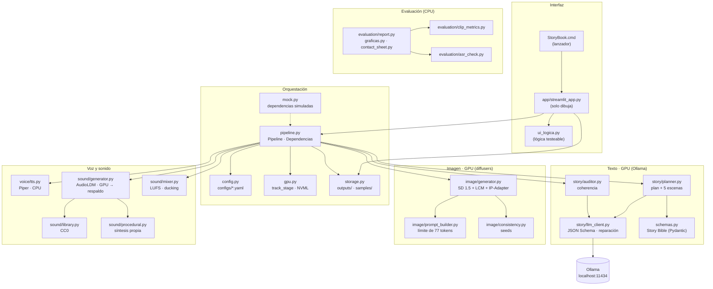
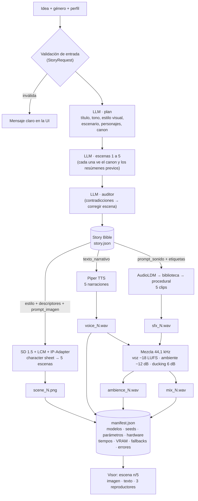
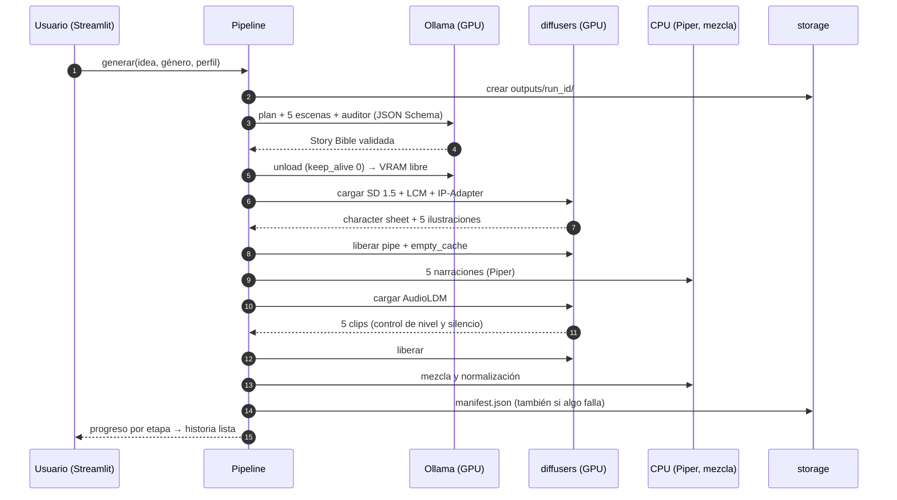
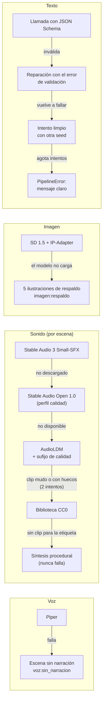

# Arquitectura de StoryBook IA

StoryBook IA convierte una **idea** y un **género** en un cuento de **5 escenas**. Cada escena trae texto narrativo, ilustración, narración y ambiente sonoro. Todo se genera en el equipo local y sin conexión, con una GPU de 4 GB.

La arquitectura responde a tres restricciones:

1. **4 GB de VRAM:** los modelos pesados no caben a la vez. El pipeline es secuencial por etapas: cada modelo se carga una vez, procesa las 5 escenas y se libera antes del siguiente.
2. **Coherencia entre modalidades:** hay una sola fuente de verdad, la **Story Bible**. Es un JSON validado con Pydantic v2 del que salen el texto, los prompts de imagen y los de sonido.
3. **Robustez en la demo:** cada etapa tiene una alternativa automática (*fallback*), y todo queda registrado en un `manifest.json`.

## 1. Componentes



| Módulo | Responsabilidad | Dónde corre |
|---|---|---|
| `schemas.py` | Story Bible y validaciones: idioma por campo, presupuesto de tokens CLIP, ids, un solo protagonista, exactamente 5 escenas | — |
| `story/` | Planificador por etapas (plan y luego escena por escena con el canon acumulado), cliente de Ollama con JSON Schema y reparación, y auditor de coherencia | GPU (Ollama) |
| `image/` | Prompt = estilo + descriptores de los personajes + acción, dentro de 77 tokens; seeds; SD 1.5 (DreamShaper 8) + LCM-LoRA + IP-Adapter con *character sheet* | GPU |
| `voice/tts.py` | Piper `es_MX-claude-high`, una voz fija con parámetros constantes | CPU |
| `sound/` | Cadena de sonido con control de calidad, biblioteca CC0, síntesis procedural y mezcla | GPU → CPU |
| `pipeline.py` | Orden de etapas, liberación de VRAM, *fallbacks*, manifest, regenerar escena y rehacer sonido | — |
| `storage.py` | `outputs/<run_id>/`, listado de historias y exportación a `samples/` (OGG) | — |
| `evaluation/` | CLIP (img-img, img-texto), WER con Whisper, `results.csv`, gráficas y hojas de contactos | CPU |
| `app/` + `ui_logica.py` | Interfaz Streamlit: formulario, progreso, visor de escenas, regenerar e historias guardadas | — |

**La lógica no depende de la interfaz:** la app solo dibuja. Todo lo testeable vive en `ui_logica.py`, `pipeline.py` y `storage.py`.

**Las dependencias pesadas se inyectan** (`Dependencias`): Ollama, diffusers y Piper se reemplazan por dobles simulados (`mock.py`). Así se prueban la UI y el pipeline completo sin GPU: 315 tests en Linux sin torch.

## 2. Flujo de datos



**Idioma por campo:** el texto narrativo, el título y los resúmenes van en español. Los prompts para el ilustrador y el sonidista van en inglés, porque SD 1.5 y AudioLDM se entrenaron con descripciones en inglés. El esquema rechaza cada campo escrito en el idioma equivocado y devuelve el error al modelo para que lo repare.

## 3. Secuencia de una generación y uso de la GPU



**Memoria medida** (batería de experimentos, `docs/informe/analisis_experimentos.md`):

| Etapa | Pico en la GPU | Comentario |
|---|---|---|
| Texto (Qwen3 4B Q4_K_M) | ~2,5 GB, 100 % en GPU | `num_ctx` 4096 y `num_gpu` 99. Se descarga antes de las imágenes: la GPU vuelve a 196–226 MB. |
| Imágenes (C3) | 3,16 GB asignados por torch, 4,03 GB reservados | El tope de NVML (4,08 GB) es sobre todo caché del asignador. VAE slicing y SDPA; sin attention slicing. |
| Sonido (AudioLDM) | 0,94 GB asignados | ~1,3 s por clip de 8 s. |
| Voz y mezcla | CPU | No compiten por la VRAM. |

Una historia completa con el perfil rápido tarda unos 2 minutos (124–129 s): texto ~60 %, imágenes ~21 %, sonido ~10 %, voz ~7 % y mezcla ~2 %.

## 4. Alternativas automáticas (*fallbacks*)



- **Texto:** es la única etapa sin la que no hay historia. Por eso tiene reparación y reintentos, y si aun así falla, un mensaje claro (por ejemplo, "Ollama no responde…").
- **Sonido:** es la etapa con más alternativas. Una escena nunca queda sin ambiente.
  - **Control de calidad:** cada clip generativo debe tener un nivel de al menos −45 dBFS y menos del 40 % del tiempo en silencio. Si no lo cumple, se reintenta con otra seed y luego se pasa al siguiente backend.
  - **Sufijo de calidad:** el sufijo ", high quality, clear" para AudioLDM se adoptó en la tarea 6.2. Llevó la tasa de clips aptos de 13/20 a 20/20 escenas.
- **Registro:** cada alternativa usada queda en `manifest.json["fallbacks"]`, por ejemplo `sonido:sa3:no_disponible`. La UI la muestra en *Detalles técnicos*.

## 5. Consistencia visual

La consistencia se demuestra con evidencia; la batería de la tarea 6.2 compara las estrategias C1, C2 y C3:

| Capa | Mecanismo | Efecto medido (CLIP img-img) |
|---|---|---|
| Story Bible | Estilo visual y descriptor fijo del personaje en cada prompt | 0,501 → 0,616 |
| Seed fija y compartida | `consistency.py` deriva las seeds de una base (1234) | (incluida en C2) |
| IP-Adapter 0,4 | *Character sheet* del protagonista como referencia visual | 0,616 → 0,765 |
| Orden del prompt `accion_primero` | La acción va antes del estilo, para no repetir retratos de frente | Elegido en las variantes de la tarea 2.3 |
| Límite de 77 tokens | `prompt_builder` recorta por prioridad (personajes > acción > estilo) y registra los truncamientos | Evita que CLIP corte el descriptor |

**Limitación conocida:** IP-Adapter aplica la identidad de la *character sheet* a cualquier persona del cuadro. Eso favorece composiciones de retrato y produce clones cuando el prompt pide un grupo. Las mitigaciones están en la sección 10 del análisis de experimentos.

## 6. Estructura de una historia guardada

```text
outputs/<AAAAMMDD_HHMMSS>_<idea>/
├── story.json           Story Bible final (con las seeds usadas)
├── manifest.json        tipo, perfil, configuración completa, modelos y versiones, hardware,
│                        tiempos y VRAM por etapa, fallbacks, errores y regeneraciones
├── character_sheet.png  referencia del protagonista (IP-Adapter)
├── scene_1..5.png       ilustraciones 768 × 512
├── voice_1..5.wav       narración (Piper)
├── sfx_1..5.wav         clip de sonido tal como salió del backend
├── ambience_1..5.wav    ambiente ajustado a la duración de la voz (sin ducking)
└── mix_1..5.wav         voz + ambiente con ducking
```

- Una historia se reabre sin regenerarla (`storage.cargar_historia`).
- Las historias de ejemplo se versionan en `samples/` con los audios en OGG Vorbis, de unos 8 MB por historia.
- `experiments/results.csv` guarda una fila por prueba, y los resúmenes van a `docs/evidencias/`.

## 7. Configuración y perfiles

| Perfil | LLM | Imagen | Sonido | Uso |
|---|---|---|---|---|
| `rapido` (por defecto) | Qwen3 4B, por etapas + auditor | LCM 6 pasos, IP-Adapter 0,4 | SA3 → AudioLDM → biblioteca → procedural | Demo; ~2 min por historia |
| `calidad` | Qwen3 4B | DPM++ 2M Karras 25 pasos | SA3 → SAO 1.0 → AudioLDM → … | Cuando el tiempo no importa |
| `experiments/c1_baseline`, `c2_bible`, `c3_ipadapter` | — | Estrategias C1, C2 y C3 | — | Batería de la tarea 6.2 |
| `experiments/llm_8b` | Qwen3 8B | — | — | Comparación de LLM (tarea 1.4) |

`config.py` valida cada YAML con Pydantic. `configs/default.yaml` tiene todos los valores, y cada perfil solo declara lo que cambia. El manifest guarda la configuración completa de cada ejecución, para que sea reproducible.

## 8. Decisiones de diseño

| Decisión | Alternativa descartada | Motivo |
|---|---|---|
| Pipeline secuencial con liberación de VRAM | Modelos residentes | Con 4 GB no caben a la vez el LLM, SD 1.5 con IP-Adapter y AudioLDM. |
| Story Bible como fuente de verdad | Prompts sueltos por modalidad | La coherencia entre texto, imagen y sonido sale de un mismo documento validado. |
| Generación por etapas (plan y luego escena por escena) | Una sola llamada | Ollama ordena las claves del JSON alfabéticamente: en una sola llamada, las escenas se generaban antes que los personajes. |
| Qwen3 4B en los dos perfiles | Qwen3 8B | Validez igual (9/10), pero el 8B es 13 veces más lento en 4 GB. |
| SD 1.5 (DreamShaper 8) + LCM | SDXL, FLUX | Exceden 4 GB; requerirían minutos por imagen. |
| Piper en CPU | XTTS-v2 | No compite por la VRAM; la licencia de XTTS restringe el uso y la clonación de voz no se necesita. |
| AudioLDM con respaldo procedural | Solo biblioteca | El enunciado valora el sonido generativo; el respaldo procedural garantiza que siempre haya ambiente. |
| Streamlit | Gradio | Estado de sesión y `st.status` para el progreso; la lógica queda separada en `ui_logica.py`. |
| Sin *safety checker* | Safety checker de SD | Ahorra ~600 MB de VRAM; se sustituye por prompts negativos, reglas por género y revisión humana. |

## 9. Calidad del software

- **Pruebas:** 315 tests con pytest. Corren sin GPU y sin red gracias a las dependencias inyectadas; cubren esquemas, prompts, pipeline completo simulado, sonido, mezcla, almacenamiento, UI, experimentos y verificación sin conexión.
- **Estilo:** ruff (lint y formato) con tipado estricto en las firmas.
- **Sin conexión:** `scripts/verify_offline.py` bloquea y registra cualquier conexión que no sea a `localhost` mientras corre el pipeline. La prueba real con el Wi-Fi apagado registró 0 intentos (tarea 5.4).
- **Trazabilidad:** cada ejecución deja su `manifest.json`. Cada prueba en Windows deja su evidencia en `docs/evidencias/` y una entrada en `docs/PROGRESO.md`.
