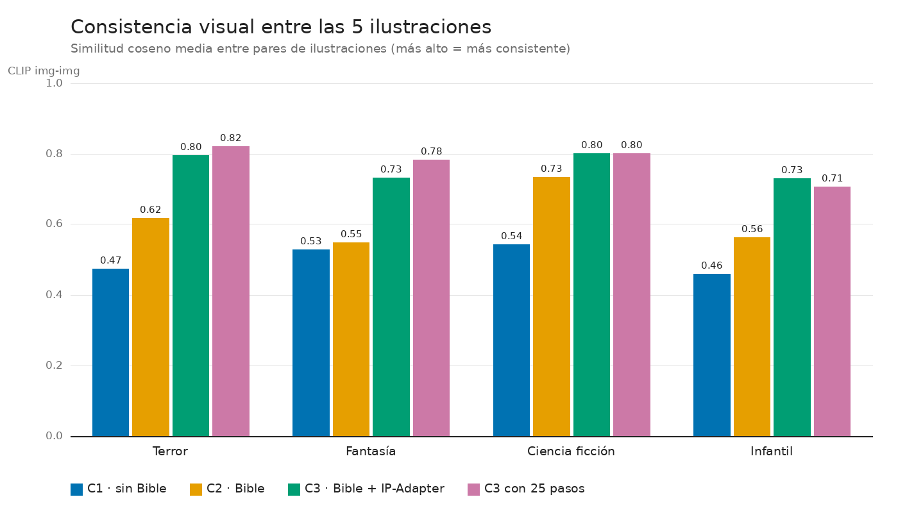
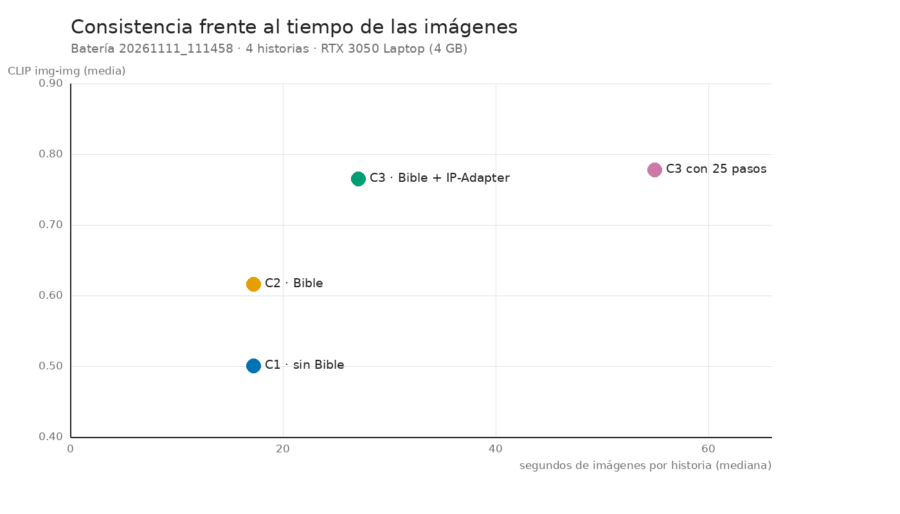
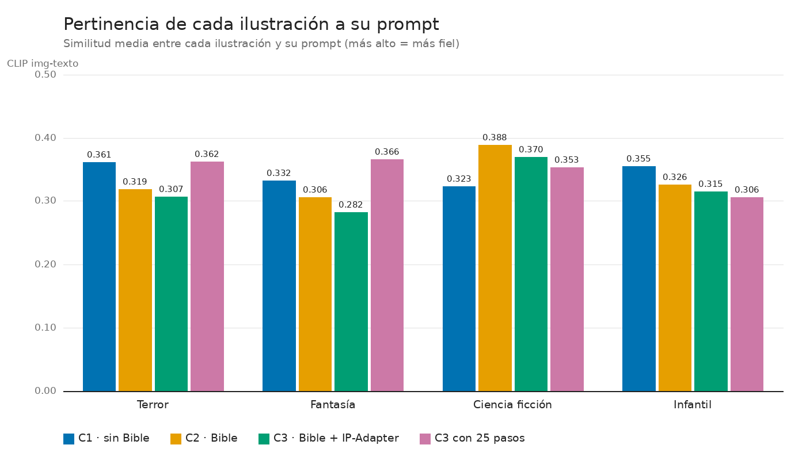
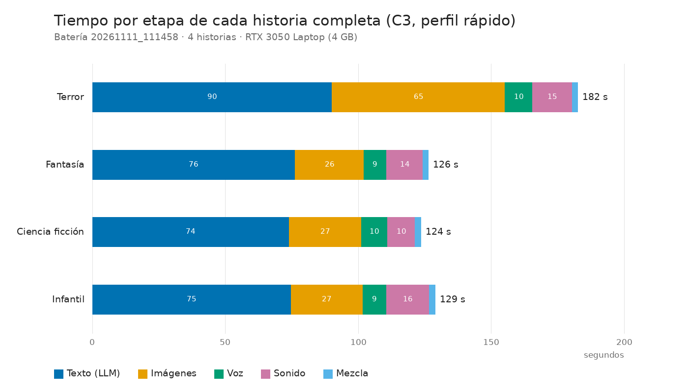
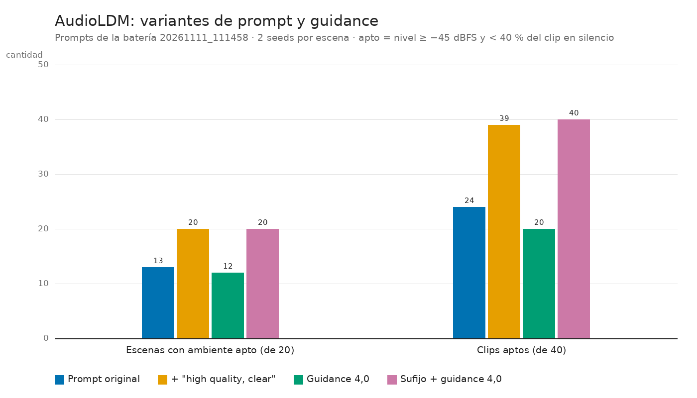

# Análisis de los experimentos (tarea 6.3)

Este documento recoge los resultados de la batería de experimentos `20261111_111458` (tarea 6.2, 11 nov 2026), de su complemento sobre AudioLDM y de la comparación de LLM de la tarea 1.4. Es la base de las secciones de resultados y discusión del informe técnico.

- **Datos:** `experiments/results.csv`, con 16 filas de la batería.
- **Resúmenes:**
  - `docs/evidencias/f6_experimentos_20261111_111458.md`;
  - `docs/evidencias/f6_audioldm_prompts.md` y `.json`;
  - `docs/evidencias/f1_resumen.md` y `f1_resumen_calidad.md`.
- **Hojas de contactos:** `docs/evidencias/f6_hojas/`.
- **Gráficas:** `docs/informe/graficas/`, regenerables con `uv run python scripts/graficas_informe.py`.

## 1. Preguntas y diseño

| Pregunta | Cómo se responde |
|---|---|
| P1. ¿Cuánto aporta cada estrategia de consistencia visual? | C1, C2 y C3 sobre las mismas historias |
| P2. ¿Qué cuesta esa consistencia (tiempo, VRAM, fidelidad al prompt)? | Tiempos por etapa, VRAM pico y CLIP img-texto |
| P3. ¿Compensan 25 pasos de difusión frente a 6 con LCM? | C3 (LCM 6 pasos) frente a `calidad` (DPM++ 25 pasos) |
| P4. ¿Es fiable el sonido generativo? | Uso de AudioLDM frente al respaldo procedural y prueba de variantes de prompt |
| P5. ¿Qué LLM conviene para el texto? | Qwen3 4B frente a Qwen3 8B (tarea 1.4) |

**Configuraciones de imagen** (`configs/experiments/`):

| Id | Story Bible en el prompt | Seed | IP-Adapter | Muestreo |
|---|---|---|---|---|
| C1 `c1_baseline` | no (solo el `prompt_imagen` de la escena) | aleatoria por escena | no | LCM, 6 pasos |
| C2 `c2_bible` | sí (estilo y descriptor fijo del personaje) | fija y compartida | no | LCM, 6 pasos |
| C3 `c3_ipadapter` (producción) | sí | fija y compartida | sí, escala 0,4 con *character sheet* | LCM, 6 pasos |
| `calidad` | sí | fija y compartida | sí, escala 0,4 | DPM++ 2M Karras, 25 pasos |

**Procedimiento** (`scripts/run_experiment.py`):

- Se usan 4 ideas, una por género: terror, fantasía, ciencia ficción e infantil.
- Para cada idea, la historia completa se genera con C3: texto, imágenes, voz, sonido y mezcla.
- Con la misma Story Bible (sin seeds), se regeneran solo las imágenes con C1, C2 y `calidad`.
- Así el texto es idéntico en las 4 configuraciones y la única variable es la estrategia de imagen.

**Métricas:**

- **CLIP img-img** (ViT-B-32, `laion2b_s34b_b79k`): similitud coseno media entre los 10 pares de ilustraciones de una historia. Mide la consistencia visual; también se reporta el par menos parecido.
- **CLIP img-texto:** similitud media entre cada ilustración y su prompt efectivo. Mide la pertinencia.
- **WER:** de Whisper small (int8, CPU) sobre la narración. Mide la inteligibilidad.
- **Tiempos por etapa y VRAM pico:** se miden con NVML, que reporta toda la GPU, y con torch, que reporta lo asignado y lo reservado.

**Hardware:** portátil con RTX 3050 Laptop (4 GB de VRAM). Todo corre localmente y sin conexión, verificado en la tarea 5.3.

## 2. Consistencia visual (P1)

| Configuración | CLIP img-img, media | CLIP img-img, peor par | CLIP img-texto | Imágenes por historia (mediana) |
|---|---|---|---|---|
| C1 · sin Bible | 0,501 | 0,326 | 0,343 | 17,2 s |
| C2 · Bible | 0,616 | 0,382 | 0,335 | 17,2 s |
| **C3 · Bible + IP-Adapter** | **0,765** | **0,618** | 0,319 | 27,1 s |
| C3 con 25 pasos (`calidad`) | 0,778 | 0,614 | 0,347 | 54,9 s |

- **El orden C3 > C2 > C1 se cumple en las 4 historias**, sin excepciones:

  | Género | C3 | C2 | C1 |
  |---|---|---|---|
  | Terror | 0,796 | 0,618 | 0,474 |
  | Fantasía | 0,732 | 0,547 | 0,528 |
  | Ciencia ficción | 0,802 | 0,734 | 0,543 |
  | Infantil | 0,731 | 0,563 | 0,459 |

- **Cuánto aporta cada componente:**
  - La Story Bible por sí sola sube la similitud media en +0,115 (+23 % sobre C1).
  - El IP-Adapter añade +0,149 (+24 % sobre C2).
  - En conjunto, +0,264 (+53 % sobre C1).
- **El peor par mejora aún más** (de 0,33 a 0,62). Sin IP-Adapter siempre hay al menos una escena en la que el personaje es otro.
- **En las hojas de contactos de C1 el personaje cambia de identidad, edad e incluso de especie.** En la historia de terror, la escena 3 muestra un robot. En C2 se mantienen rasgos y vestuario aproximados, pero varían el peinado, el color de la ropa y la edad aparente.

## 3. El costo de la consistencia (P2)

- **Tiempo:** el IP-Adapter suma unos 10 s por historia (de 17 a 27 s), por la *character sheet* y la carga del adaptador. Frente a una historia completa de unos 2 minutos, es un costo menor.
- **Fidelidad al prompt:** el CLIP img-texto baja de 0,343 (C1) a 0,319 (C3). C1 supera a C3 en 3 de las 4 historias; la excepción es ciencia ficción.

  

  La imagen de referencia compite con el texto de la escena. La revisión de las hojas lo confirma: con C3 casi todas las escenas se convierten en un **retrato del protagonista mirando a la cámara**, y la acción descrita queda en el fondo o desaparece.
- **Artefacto de clones:** cuando el prompt pide un grupo ("cuatro amigos caminan"), el IP-Adapter dibuja varias copias del protagonista. Pasa en la escena 2 de "El Camino de los Amigos", tanto en C3 como en `calidad`.
- **Matiz sobre la métrica:** parte del CLIP img-img alto de C3 se debe a esa composición repetida (retrato centrado, mismo encuadre), no solo a la identidad del personaje. CLIP mide similitud global de la imagen, no identidad facial. Por eso la consistencia debe leerse junto con las hojas de contactos y con la pertinencia.
- **VRAM:** la etapa de imágenes es el cuello de botella.

  | Configuración | torch, asignado | torch, reservado | NVML (toda la GPU) |
  |---|---|---|---|
  | C3 | 3156 MB | 4034 MB | 4076 MB |
  | C1/C2 | 3113 MB | 3980 MB | 4086 MB |
  | `calidad` | 3014 MB | 3844 MB | 4070 MB |

  - El pico de NVML está casi en el tope de 4096 MB, pero se debe sobre todo a la caché del asignador de torch. La memoria realmente usada deja unos 900 MB de margen.
  - Al cargar las imágenes la GPU parte de 196–226 MB: el LLM de Ollama se libera bien antes de esa etapa.
  - AudioLDM llega a 943 MB asignados. La voz (Piper) corre en CPU.

## 4. LCM 6 pasos frente a DPM++ 25 pasos (P3)

- **Consistencia:** prácticamente igual, 0,778 frente a 0,765 (+0,013). `calidad` gana en terror y fantasía, empata en ciencia ficción y pierde en infantil.
- **Pertinencia:** algo mayor con 25 pasos, 0,347 frente a 0,319.
- **Calidad visual en las hojas:** imágenes más limpias, con mejor iluminación y fondos más definidos. Los mismos problemas de composición (retratos, clones) siguen presentes.
- **Costo:** el doble de tiempo de imágenes, 55 s frente a 27 s por historia.
- **Decisión:** LCM con 6 pasos se mantiene en el perfil rápido, que es el que se usa en la demo. El perfil `calidad` queda como opción cuando el tiempo no importa.

## 5. Tiempos de punta a punta y narración

- **Una historia completa con C3 tarda entre 124 y 129 s** (mediana 127,7 s), muy por debajo del objetivo de menos de 5 minutos.
- **Reparto del tiempo:**
  - el texto (Qwen3 4B, por etapas y con auditor) toma 74–90 s, el 60 % del total;
  - las imágenes, unos 27 s;
  - el sonido, 10–16 s;
  - la voz, unos 9 s;
  - la mezcla, unos 2 s.
- **La primera historia tardó 182 s,** porque las imágenes tomaron 65 s. Con toda probabilidad es un efecto de arranque en frío: era la primera carga de los pesos desde el disco en esa sesión.
- **La narración se entiende bien:** WER medio entre 0,035 y 0,048. En la revisión de la tarea 3.3, los errores se concentraron en nombres propios inventados y en cifras.

## 6. Sonido generativo (P4)

- **En la batería, AudioLDM quedó en 12 de 20 escenas.** Por historia: ciencia ficción 5/5, fantasía 4/5, terror 2/5 e infantil 1/5. Las 8 restantes pasaron al respaldo procedural.
- **La causa no fue un error:** fueron clips casi mudos, de −47 a −75 dBFS o con más del 40 % del tiempo en silencio, que el control de calidad rechazó.
- **Los prompts que fallaban describen fuentes tenues:** "wind rustling through trees", "birds sing", "wind through trees…". En cambio, "wind howls" o "machinery hums" funcionaban.
- **Prueba de variantes:** con los 20 prompts de la batería y 2 seeds por escena (`scripts/f6_audioldm_prompts.py`) se probaron cuatro variantes:

| Variante | Escenas con ambiente apto | Clips aptos | Nivel mediano |
|---|---|---|---|
| Prompt original (guidance 2,5) | 13/20 | 24/40 | −18,2 dBFS |
| **+ ", high quality, clear"** | **20/20** | 39/40 | −14,6 dBFS |
| Guidance 4,0 | 12/20 | 20/40 | −21,4 dBFS |
| Sufijo + guidance 4,0 | 20/20 | 40/40 | −9,2 dBFS |

- **El sufijo de calidad resuelve todos los casos.** Subir el guidance, por sí solo, empeora el resultado.
- **Lo que se mide es la combinación de dos cambios:** con "high quality" en el prompt, el sistema quita "low quality" del negative prompt para no contradecirlo.
- **Se adoptó solo el sufijo** (`audioldm_sufijo`), con el guidance en 2,5.
- **Validación en la aplicación:** al rehacer las 6 escenas procedurales de las historias de `samples/`, las 6 pasaron a AudioLDM al primer intento. Las 3 historias de ejemplo usan ahora AudioLDM en sus 15 escenas.
- **El respaldo procedural sigue siendo necesario.** Garantiza que ninguna escena quede sin ambiente aunque el modelo falle o no esté descargado.
- **Stable Audio 3 Small-SFX**, la primera opción de la cadena, no se pudo evaluar: su repositorio exige aceptar condiciones con una cuenta.

## 7. LLM para el texto (P5, tarea 1.4)

| Modelo | Story Bibles válidas | Tiempo por historia (mediana) | tokens/s | Intentos por llamada | Fracción en GPU |
|---|---|---|---|---|---|
| **Qwen3 4B Instruct 2507** (Q4_K_M) | 9/10 | **75 s** | 42,9 | 1,07 | 1,00 |
| Qwen3 8B (Q4_K_M) | 9/10 | 982 s (~16 min) | 3,0 | 1,57 | 0,39 |

- **El 8B no cabe entero en 4 GB:** corre el 61 % en CPU. Es 13 veces más lento, necesita más reintentos (sobre todo por campos en el idioma equivocado) y no mejora la tasa de éxito.
- **Decisión:** se usa el 4B en los dos perfiles.

## 8. Conclusiones

1. **Consistencia (P1):** combinar Story Bible, seed fija e IP-Adapter es la estrategia más consistente, con +53 % de similitud entre ilustraciones frente a la línea base, en las 4 historias. La Bible aporta la mitad de la mejora y el IP-Adapter la otra mitad.
2. **Costo (P2):** la consistencia cuesta unos 10 s y algo de fidelidad al prompt, y favorece composiciones de retrato. Es el principal punto de mejora visual.
3. **Pasos (P3):** 25 pasos no justifican el doble de tiempo en el perfil de demo.
4. **Sonido (P4):** AudioLDM es viable en 4 GB (unos 0,9 GB asignados y ~1,3 s por clip de 8 s), pero sensible al prompt. Un sufijo de calidad lleva la tasa de éxito de 65 % a 100 % en este conjunto. El respaldo procedural asegura que siempre haya sonido.
5. **Texto (P5):** con 4 GB de VRAM, el 4B es la única opción práctica.
6. **Una historia completa tarda unos 2 minutos**, sin conexión, en una GPU de 4 GB.

## 9. Limitaciones y amenazas a la validez

- **Muestra pequeña:** 4 historias por configuración, una seed por configuración y un solo equipo. Las diferencias grandes (C1 frente a C3) son consistentes en las 4 historias. Las pequeñas (C3 frente a `calidad`, de +0,013) no son concluyentes.
- **CLIP es una medida indirecta:** no mide identidad facial ni calidad estética, y premia composiciones repetidas (ver la sección 3).
- **El control de sonido solo verifica nivel y silencio,** no que el audio corresponda al prompt. Medir eso requeriría un modelo como CLAP, que no está en el alcance.
- **Seeds de C1:** sus seeds aleatorias quedan registradas en cada `story.json`, pero solo se probó un juego de seeds por historia.
- **Lista 1–5:** las columnas `narrativa_1a5`, `visual_1a5`, `audio_1a5` y `funcionamiento_1a5` de `results.csv` quedan por llenar con una revisión humana de las hojas de contactos y los audios (tarea 7.3).

## 10. Observaciones para trabajo futuro

- **Menos retratos con IP-Adapter:**
  - ajustar la escala por escena (más baja en escenas de acción o de grupo);
  - usar una máscara del personaje;
  - anteponer en el prompt el encuadre y la acción ("wide shot, full body, …").
- **Varios personajes:** hoy hay un solo personaje fijo por historia. En "Un perro y un gato…" el LLM convirtió la pareja en un niño con un gato y el perro desapareció.
- **Variedad del sonido:** el LLM repite "wind" + "heartbeat" en casi todos los `prompt_sonido`, sin importar el género. Conviene pedir fuentes concretas del lugar de cada escena y medir la correspondencia audio-texto con CLAP.
