# StoryBook IA

**Generación local de cuentos multimodales de 5 escenas con texto, ilustración, narración y ambiente sonoro**

Documento técnico del proyecto integrador 
Electiva Ingeniería Aplicada – Inteligencia Artificial Generativa (grupo ISS9B) 
Ingeniería de Sistemas · Universidad Santo Tomás, Seccional Tunja

Autor: Diego Alejandro Urbano Pira (código 2386899) 
Docente: `[DATO PENDIENTE]` 
Fecha de entrega: 23 de noviembre de 2026 
Repositorio: <https://github.com/DiegoAlejandroU/StoryBook-IA>

---

## Resumen

StoryBook IA es una aplicación de escritorio que convierte una idea breve y un género literario en un cuento ilustrado de exactamente cinco escenas. Cada escena trae texto narrativo en español, una ilustración original, una narración con voz sintética y un ambiente sonoro mezclado bajo la voz.

Todo se genera en un portátil con una GPU de 4 GB (RTX 3050 Laptop), sin conexión a Internet y sin servicios de pago.

**Arquitectura:**
- Pipeline secuencial que carga y libera un modelo pesado por etapa:
  - Qwen3 4B (vía Ollama) para el texto;
  - Stable Diffusion 1.5 (DreamShaper 8) con LCM-LoRA e IP-Adapter para las imágenes;
  - Piper para la voz;
  - AudioLDM, con respaldo procedural, para el sonido.
- Una *Story Bible* validada con Pydantic es la única fuente de verdad entre modalidades.

**Resultados** (batería de 4 historias, una por género):
- Una historia completa tarda unos 2 minutos (124–129 s).
- La combinación de Story Bible, seed fija e IP-Adapter eleva la consistencia visual (CLIP img-img) de 0,50 a 0,77 frente a la línea base, en las 4 historias.
- La narración tiene un error de palabras del 3,5–4,8 %.
- Un sufijo de calidad en el prompt de AudioLDM llevó las escenas con ambiente apto de 13/20 a 20/20.
- La prueba con el Wi-Fi apagado no registró ningún intento de conexión fuera del equipo.

---

## 1. Problema y objetivo

**Problema.** Los sistemas de narración multimodal suelen depender de APIs en la nube: GPT, DALL·E, ElevenLabs. Eso implica costo por uso, envío de datos a terceros y dependencia de la conexión. Producir localmente un cuento coherente en texto, imagen, voz y sonido, con hardware de consumo, tiene tres dificultades:

1. **Memoria:** con 4 GB de VRAM no caben a la vez un LLM, un modelo de difusión y un modelo de audio.
2. **Coherencia entre escenas:** cada imagen se genera de forma independiente, y el personaje tiende a cambiar de cara, ropa o edad.
3. **Coherencia entre modalidades:** el texto, la imagen y el sonido de una escena deben contar lo mismo.

**Objetivo general.** Construir una aplicación local que, a partir de una idea y un género, genere un cuento de exactamente 5 escenas, cada una con:
- texto narrativo en español;
- ilustración original;
- narración con voz sintética;
- ambientación sonora.

Debe usar solo modelos abiertos ejecutados en el equipo y ser reproducible.

**Objetivos específicos:**

1. Diseñar un pipeline que respete el límite de 4 GB de VRAM y termine una historia en menos de 5 minutos con el perfil rápido.
2. Mantener la consistencia visual del protagonista entre escenas y medirla con métricas objetivas (CLIP).
3. Comparar al menos dos configuraciones de consistencia y de modelos con datos, y justificar las decisiones con esas mediciones.
4. Garantizar el funcionamiento sin conexión y con alternativas automáticas (*fallbacks*) cuando un modelo falle.
5. Entregar un repositorio reproducible con interfaz gráfica, pruebas automatizadas, evidencias y documentación.

## 2. Arquitectura y flujo de datos

El sistema es un **pipeline secuencial orquestado por etapas** (`src/storybook/pipeline.py`).

- **Una sola fuente de verdad:** la *Story Bible*, un JSON validado con Pydantic v2 que genera el LLM.
- **De ella sale todo:** el texto de cada escena, el prompt de cada ilustración (estilo + descriptor fijo del personaje + acción) y el prompt de cada ambiente sonoro.
- **Un modelo pesado a la vez:** cada uno se carga una vez, procesa las 5 escenas y se libera antes del siguiente.

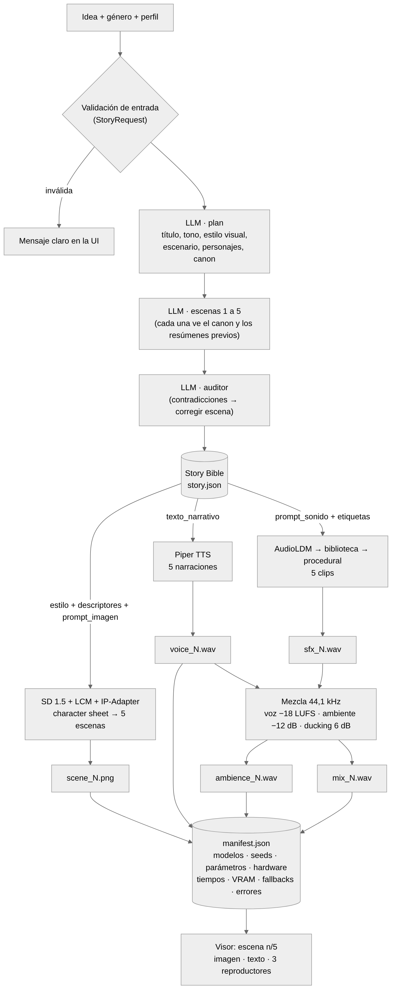

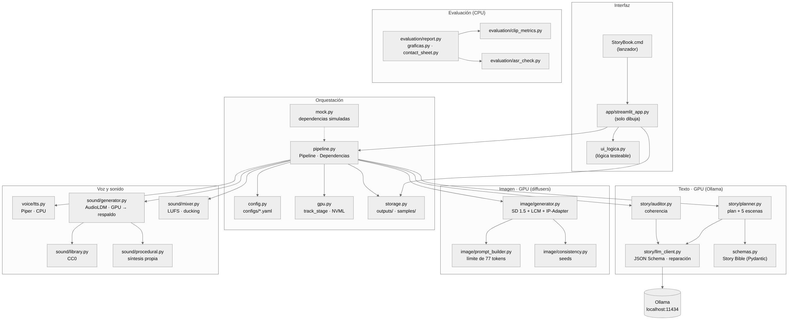

| Etapa | Recurso | Modelo o técnica | Salida |
|---|---|---|---|
| 1. Validación de la entrada | CPU | Pydantic (`StoryRequest`) | Idea, género y perfil validados |
| 2. Texto | GPU (Ollama) | Qwen3 4B: plan, 5 escenas y auditor | `story.json` (Story Bible) |
| 3. Imágenes | GPU | SD 1.5 + LCM-LoRA + IP-Adapter | `character_sheet.png`, `scene_1..5.png` |
| 4. Voz | CPU | Piper `es_MX-claude-high` | `voice_1..5.wav` |
| 5. Sonido | GPU → CPU | AudioLDM → biblioteca CC0 → procedural | `sfx_1..5.wav` |
| 6. Mezcla | CPU | Normalización LUFS y *ducking* | `ambience_1..5.wav`, `mix_1..5.wav` |
| 7. Persistencia | Disco | `storage.py` | `manifest.json` y la carpeta de la historia |
| 8. Interfaz | Navegador local | Streamlit | Visor de escenas |

El paso de la GPU entre modelos se ve en la secuencia de una generación:

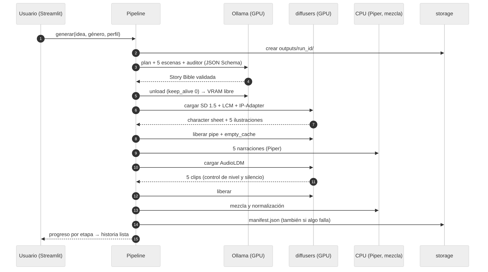

**Diseño para pruebas.** Las dependencias pesadas (Ollama, diffusers y Piper) se inyectan en el pipeline (`Dependencias`), y `storybook.mock` las reemplaza por dobles simulados. Así, la interfaz y el pipeline completo se prueban sin GPU: 316 pruebas automatizadas corren en Linux sin torch. La interfaz (`app/streamlit_app.py`) solo dibuja; su lógica está en `ui_logica.py` y también tiene pruebas.

El detalle de módulos, decisiones y diagramas está en `docs/arquitectura.md`.

## 3. Tecnologías y modelos

La restricción que domina todas las decisiones es la GPU de 4 GB (RTX 3050 Laptop, 75 W). También hay 24 GB de RAM y la obligación de funcionar sin conexión.

| Modalidad | Modelo elegido | Por qué, dada la restricción de 4 GB |
|---|---|---|
| Texto | **Qwen3-4B-Instruct-2507** (Q4_K_M, ~2,5 GB) vía Ollama | Cabe completo en la GPU con `num_ctx` 4096 (43 tok/s). Genera JSON estructurado en español con salida guiada por JSON Schema. Licencia Apache 2.0. |
| Imagen | **DreamShaper 8** (SD 1.5) + **LCM-LoRA** | SD 1.5 en fp16 cabe en ~3,2 GB. LCM reduce el muestreo a 6 pasos (3,4 s por imagen de 768 × 512). DreamShaper da un estilo ilustrativo. |
| Consistencia | **IP-Adapter SD 1.5** (escala 0,4) | Condiciona cada escena con una *character sheet* del protagonista, sin entrenar nada. |
| Voz | **Piper** `es_MX-claude-high` | Corre en CPU en tiempo real (RTF 0,03), así que no compite por la VRAM. La eligió Diego al escuchar 3 voces. |
| Sonido | **AudioLDM** s-full (421 M) | Text-to-audio en ~0,9 GB y ~1,3 s por clip de 8 s. No exige token. |
| Sonido (respaldo) | Biblioteca CC0 y **síntesis procedural** propia (numpy/scipy) | Garantizan que siempre haya ambiente, aunque falle el modelo generativo. |
| Evaluación | OpenCLIP ViT-B-32 y faster-whisper small (int8) | Corren en CPU, solo para medir. |

**Alternativas descartadas:**

| Alternativa | Motivo |
|---|---|
| Qwen3 8B | Medido en la tarea 1.4: la misma validez (9/10) que el 4B, pero 13 veces más lento (~16 min por historia), con el 61 % del modelo en CPU. |
| SDXL, FLUX.1-schnell | Exceden 4 GB; con offload secuencial tardan minutos por imagen. |
| Stable Audio 3 Small-SFX y Stable Audio Open 1.0 | Exigen aceptar su licencia con una cuenta. Quedan en la cadena y se usan si están descargados; en el equipo de referencia no lo están, así que se usa AudioLDM. |
| XTTS-v2 | Compite por la VRAM; su licencia (CPML) restringe el uso y su clonación de voz no se necesita (ver la sección 11). |
| MusicGen | El enunciado pide ambientes y efectos, no música; su licencia es CC BY-NC. |
| Safety checker de SD | Ocupa ~600 MB de VRAM; se sustituye por prompts negativos, reglas por género y revisión humana. |
| Gradio | Streamlit da estado de sesión y progreso por etapa (`st.status`) con menos código de interfaz. |

Las revisiones exactas, las licencias y las mediciones por modelo están en `MODELS.md` y `docs/models_registry.json`.

## 4. Procedimiento de generación de las 5 escenas

1. **Entrada:** idea (hasta 500 caracteres), género y perfil. El género es uno de terror, fantasía, misterio, aventura, ciencia ficción, infantil u "otro" con texto libre. La entrada se valida antes de usar la GPU.
2. **Plan (1 llamada al LLM):** título, tono, estilo visual (técnica, paleta, iluminación), escenario, personajes y canon inicial.
   - Cada personaje tiene un descriptor visual fijo en inglés de hasta 25 tokens.
   - La salida está restringida por un JSON Schema generado desde Pydantic.
   - El género lo copia el código desde la solicitud, no el LLM.
3. **Escenas (5 llamadas):** cada escena recibe el plan, los resúmenes de las anteriores, el canon acumulado y la regla del género (por ejemplo, infantil: "sin violencia ni miedo intenso, final esperanzador").
   - Cada una produce su fase, el texto narrativo en español (90–160 palabras), un resumen, los personajes presentes, hechos nuevos, `prompt_imagen` y `prompt_sonido` (en inglés) y etiquetas de sonido.
   - Las fases son inicio, desarrollo, desarrollo, clímax y desenlace.
4. **Validación y reparación:**
   - El esquema rechaza los campos en el idioma equivocado, los ids inexistentes, más de un protagonista y los prompts que exceden el presupuesto de CLIP.
   - El error de validación se devuelve al modelo para que repare su respuesta. Si la reparación falla, el intento siguiente empieza de cero con otra seed.
   - Por qué se generan por etapas: Ollama ordena alfabéticamente las claves del JSON, y en una sola llamada las escenas se escribían antes que los personajes.
5. **Auditor:** una llamada final busca contradicciones de nombres, rasgos y hechos, y corrige la escena afectada. Después se descarga el LLM de la GPU.
6. **Imágenes:**
   - Primero se genera la *character sheet* del protagonista.
   - Luego cada escena, con prompt = acción y composición + descriptores de los personajes presentes + estilo visual, en ese orden (`accion_primero`).
   - `prompt_builder` verifica con el tokenizer el límite de 77 tokens de CLIP. Si se excede, recorta por prioridad y registra el recorte.
   - Seed fija y compartida, negative prompt común, 768 × 512.
7. **Voz:** una sola voz y parámetros constantes para las 5 narraciones.
8. **Sonido:** cada `prompt_sonido` se limpia (se quitan adjetivos de intensidad baja como "soft" y menciones de silencio) y se le agrega ", high quality, clear".
   - Un control descarta los clips de menos de −45 dBFS o con más del 40 % del tiempo en silencio.
   - Si un clip falla, se reintenta con otra seed y luego se pasa al siguiente backend: biblioteca y después síntesis procedural.
9. **Mezcla:**
   - El ambiente se ajusta a la duración de la voz (bucle con fundido cruzado).
   - Se normaliza: voz a −18 LUFS y ambiente 12 dB por debajo, con *ducking* de 6 dB mientras se habla.
   - Se exportan la pista de ambiente y la mezcla.
10. **Persistencia:** todo queda en `outputs/<run_id>/`, con un `manifest.json` que se escribe incluso si algo falla. La historia se reabre sin regenerarla, y cada escena se puede regenerar sola desde la interfaz.

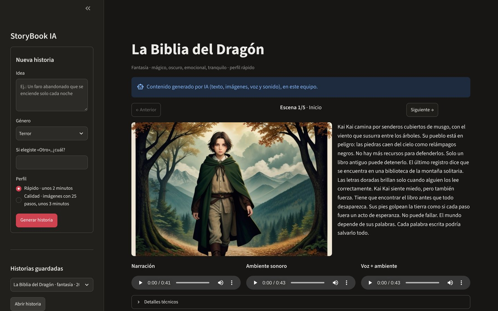

## 5. Estrategia de consistencia

La consistencia se trabaja en tres niveles.

**Narrativa:**
- La Story Bible fija los personajes, sus rasgos y el canon.
- Cada escena se escribe viendo el canon acumulado y los resúmenes previos.
- El auditor busca contradicciones al final.

**Visual (cinco capas):**
1. **Story Bible en el prompt:** el estilo visual y el descriptor fijo de cada personaje presente se repiten, idénticos, en las 5 escenas.
2. **Seed fija y compartida:** `consistency.py` deriva las seeds de una base (1234), para que el ruido inicial no varíe entre escenas.
3. **IP-Adapter 0,4:** usa la *character sheet* como referencia de identidad. La escala se eligió en la tarea 2.3:
   - con 0,6, todas las escenas eran retratos de frente;
   - con 0,25, a veces desaparecía el protagonista.
4. **Orden `accion_primero`:** la acción va antes del estilo, para que la escena muestre lo que ocurre.
5. **Límite de 77 tokens:** evita que CLIP corte el descriptor del personaje al final del prompt.

**Entre modalidades:**
- El texto, el prompt de imagen y el prompt de sonido de una escena salen de la misma entrada de la Bible.
- La voz y el ambiente se mezclan con niveles fijos, para que el sonido acompañe sin tapar la narración.

La sección 8 cuantifica el aporte de cada capa visual.

## 6. Configuraciones y experimentos

**Perfiles de uso** (`configs/`):
- `rapido` (por defecto): LCM 6 pasos y la cadena de sonido SA3 → AudioLDM → biblioteca → procedural.
- `calidad`: DPM++ 2M Karras con 25 pasos, y Stable Audio Open en la cadena de sonido.

**Configuraciones experimentales** (`configs/experiments/`):

| Id | Story Bible | Seed | IP-Adapter | Muestreo |
|---|---|---|---|---|
| C1 `c1_baseline` | No: solo el `prompt_imagen` de la escena | Aleatoria por escena | No | LCM, 6 pasos |
| C2 `c2_bible` | Sí | Fija y compartida | No | LCM, 6 pasos |
| C3 `c3_ipadapter` (producción) | Sí | Fija y compartida | Sí, 0,4 | LCM, 6 pasos |
| `calidad` | Sí | Fija y compartida | Sí, 0,4 | DPM++ 2M Karras, 25 pasos |
| `llm_8b` | — | — | — | Qwen3 8B en vez del 4B |

**Diseño de la batería** (`scripts/run_experiment.py`, tarea 6.2):
- 4 ideas, una por género: terror, fantasía, ciencia ficción e infantil.
- Para cada idea, la historia completa se genera con C3. Con la misma Story Bible se regeneran solo las imágenes con C1, C2 y `calidad`, así que la única variable es la estrategia de imagen.
- Cada prueba es una fila de `experiments/results.csv`: configuración, seeds, tiempos por etapa, VRAM, CLIP, WER y *fallbacks*.

**Experimentos complementarios:**
- **LLM 4B frente a 8B** (tarea 1.4): 10 historias con cada modelo.
- **Variantes de prompt y guidance para AudioLDM** (complemento de 6.2): 20 prompts × 4 variantes × 2 seeds.
- **Variantes de IP-Adapter y orden del prompt** (tarea 2.3): escalas 0,25, 0,4 y 0,6, con estilo primero o acción primero.

**Métricas:**
- **CLIP img-img:** similitud coseno media entre los 10 pares de ilustraciones de una historia. Mide la consistencia.
- **CLIP img-texto:** similitud entre cada ilustración y su prompt efectivo. Mide la pertinencia.
- **WER:** error de palabras de Whisper small sobre la narración. Mide la inteligibilidad.
- **Tiempo por etapa y VRAM pico:** con NVML y torch.
- **Nivel y silencio de los clips de sonido.**

## 7. Evidencias de pruebas

Cada prueba en el equipo de referencia se ejecutó con `scripts/setup_windows.ps1`, que guarda la salida en `docs/evidencias/` y hace commit de las evidencias. Cada una tiene su entrada en la bitácora de `docs/PROGRESO.md`.

| Fecha | Prueba | Resultado | Evidencia |
|---|---|---|---|
| 9–10 nov | Entorno: CUDA, torch, descarga de modelos y diagnóstico | Todo en verde; modelos registrados con su revisión | `check_env.txt`, `download_models.txt`, `docs/models_registry.json` |
| 10 nov | F1: 10 Story Bibles con el 4B y 10 con el 8B | 4B: 9/10 válidas en 75 s. 8B: 9/10 en 982 s. | `f1_resumen.md`, `f1_resumen_calidad.md` |
| 10 nov | F2: imágenes reales y variantes de IP-Adapter | IP 0,4 + `accion_primero` elegido | `f2_f3_resumen.md`, `f2_variantes.md` |
| 10 nov | F3: 3 voces de Piper con WER | WER de 4,7 % a 8,3 % (mediana); voz elegida al escucharlas | `f2_f3_resumen.md` |
| 10 nov | F4: sonido y mezcla (cadena frente a procedural) | AudioLDM en las 5 escenas, 1,3 s por clip; voz −18 LUFS y ambiente −30 LUFS | `f4_sonido.md` |
| 10 nov | F5: verificación sin conexión, con el Wi-Fi apagado | 3 historias completas (126–138 s), **0 conexiones externas** | `verify_offline.txt` |
| 11 nov | F6: batería C1/C2/C3/calidad × 4 géneros | 16/16 pruebas con 5 escenas (sección 8) | `f6_experimentos_20261111_111458.md`, `f6_hojas/` |
| 11 nov | F6: variantes de prompt de AudioLDM | 20/20 escenas aptas con el sufijo de calidad | `f6_audioldm_prompts.md` |
| 11 nov | Ejemplos rehechos con el sufijo | 6/6 escenas pasaron a AudioLDM al primer intento | `exportar_muestras.txt` |
| Continuo | Pruebas automatizadas (pytest) y lint (ruff) | 316 pruebas en verde, sin GPU ni red | `pytest.txt` |

**Lista de verificación 1–5 por historia** (narrativa, visual, audio y funcionamiento): `[DATO PENDIENTE]`. Las columnas `*_1a5` de `experiments/results.csv` se llenan con la revisión humana de las hojas de contactos y de los audios.

## 8. Resultados y análisis

El análisis completo está en `docs/informe/analisis_experimentos.md`. Aquí se resumen los hallazgos.

### 8.1 Consistencia visual

| Configuración | CLIP img-img (media) | Peor par | CLIP img-texto | Imágenes por historia |
|---|---|---|---|---|
| C1 · sin Bible | 0,501 | 0,326 | 0,343 | 17,2 s |
| C2 · Bible | 0,616 | 0,382 | 0,335 | 17,2 s |
| **C3 · Bible + IP-Adapter** | **0,765** | **0,618** | 0,319 | 27,1 s |
| C3 con 25 pasos | 0,778 | 0,614 | 0,347 | 54,9 s |

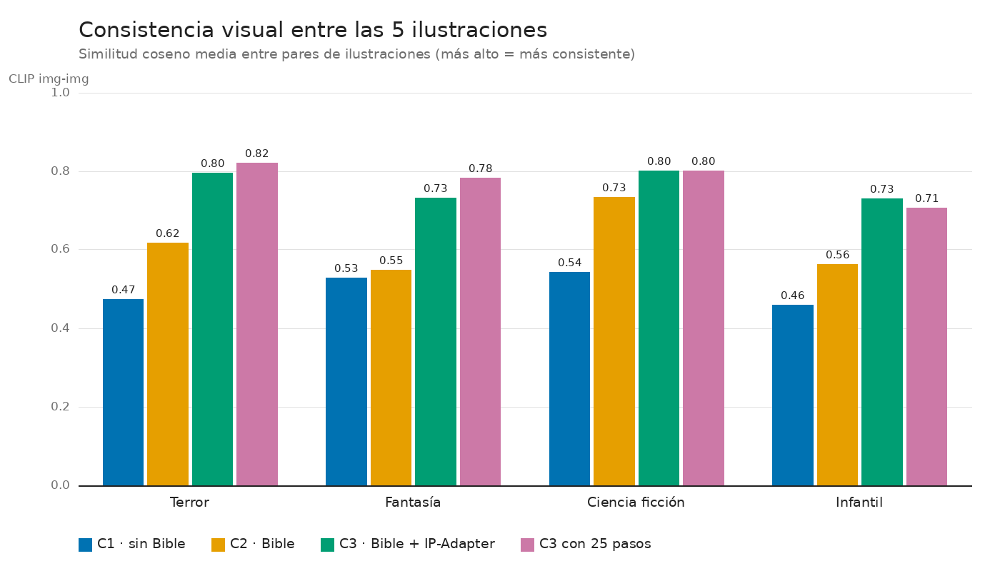

- **El orden C3 > C2 > C1 se cumple en las 4 historias.**
  - La Story Bible por sí sola aporta +0,115 (+23 %).
  - El IP-Adapter aporta +0,149 adicional (+24 %).
  - En conjunto, +53 % sobre la línea base.
- **El peor par sube de 0,33 a 0,62.** Sin IP-Adapter siempre hay al menos una escena con otro personaje. En C1, en la historia de terror, el protagonista llega a convertirse en un robot.

| C1 · sin Bible (terror) | C3 · Bible + IP-Adapter (terror) |
|---|---|
| 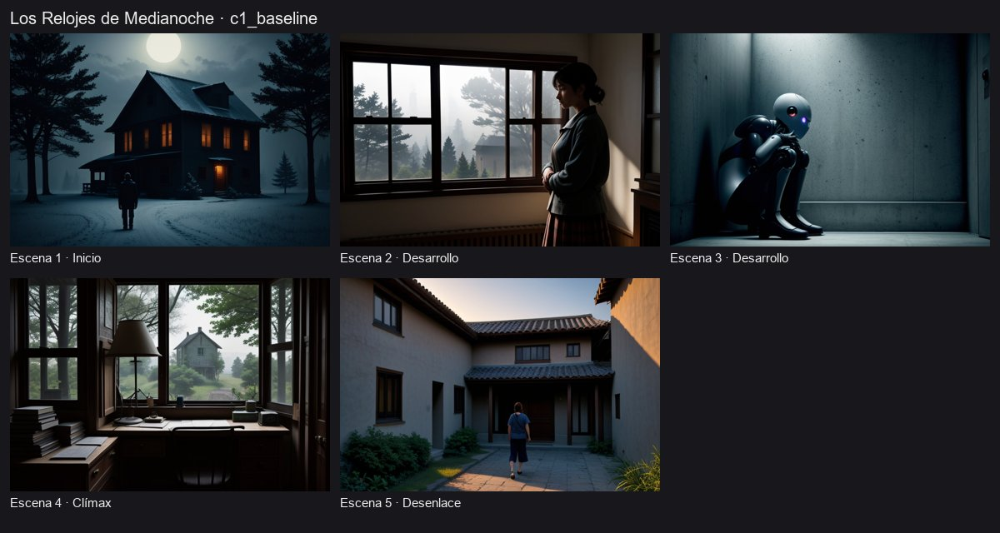 | 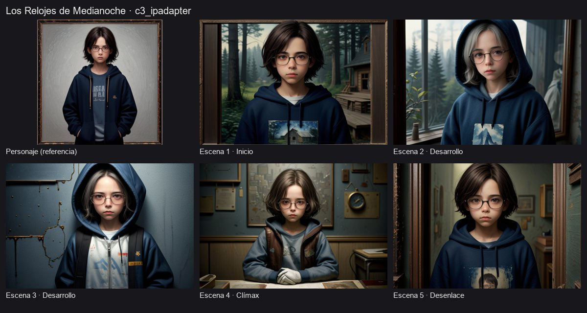 |

### 8.2 El costo de la consistencia

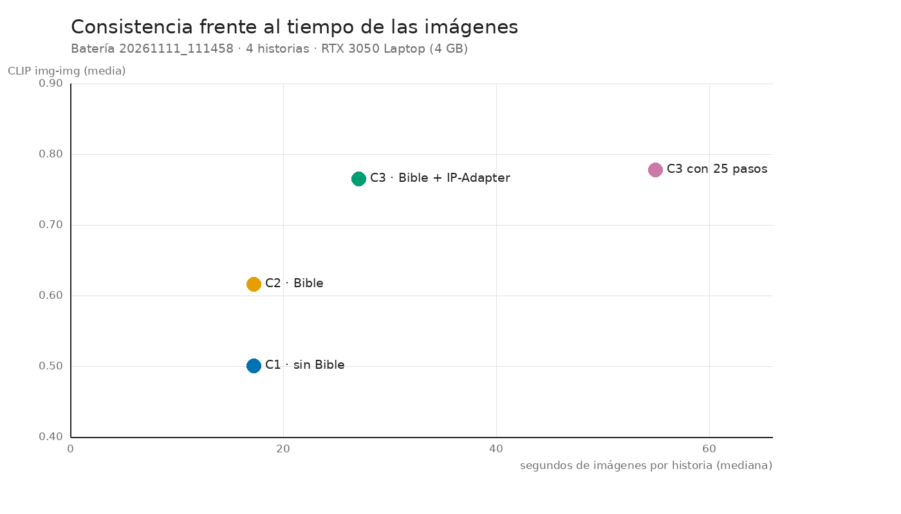

- **Tiempo:** el IP-Adapter suma unos 10 s por historia.
- **Fidelidad al prompt:** CLIP img-texto baja de 0,343 a 0,319, y C1 supera a C3 en 3 de las 4 historias. La referencia del personaje compite con el texto de la escena.
- **Composición:** en las hojas de contactos, C3 tiende a mostrar al protagonista de frente, como un retrato, y con poca acción.
- **Clones:** cuando el prompt pide un grupo, aparecen copias del protagonista.
- **Matiz sobre la métrica:** parte del CLIP img-img alto de C3 se debe a esa composición repetida y no solo a la identidad del personaje.

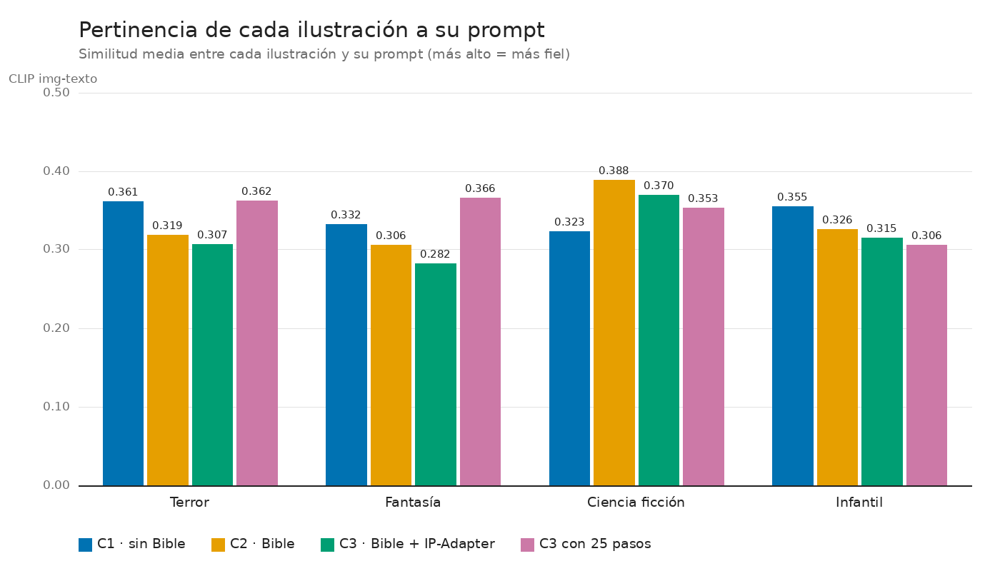

### 8.3 LCM frente a DPM++ 25 pasos

Con 25 pasos, la consistencia es prácticamente igual (+0,013), la pertinencia algo mayor (+0,028) y las imágenes más limpias, pero tarda el doble (55 frente a 27 s). Por eso el perfil de la demo usa LCM con 6 pasos.

### 8.4 Tiempos de punta a punta y narración

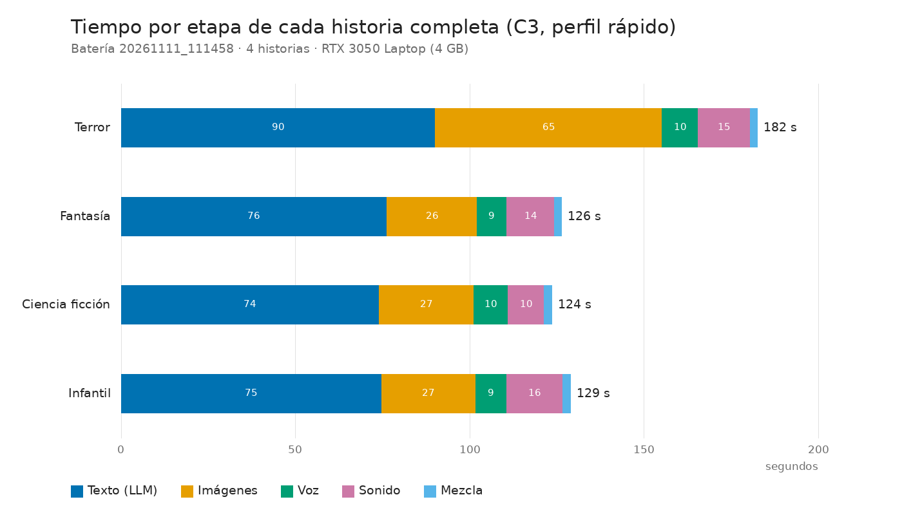

- **Una historia completa tarda entre 124 y 129 s,** frente a un objetivo de menos de 5 minutos.
- **El texto ocupa el 60 % del tiempo** (74–90 s). La primera historia tardó 182 s por la carga en frío de los pesos de imagen.
- **La narración se entiende bien:** WER de 3,5 a 4,8 %; los errores se concentran en nombres propios inventados.

### 8.5 Sonido generativo

- **En la batería, AudioLDM quedó solo en 12 de 20 escenas;** las otras 8 cayeron al respaldo procedural.
- **Los prompts que fallaban describen fuentes tenues** ("wind rustling through trees", "birds sing"). El modelo devolvía clips de −47 a −75 dBFS.

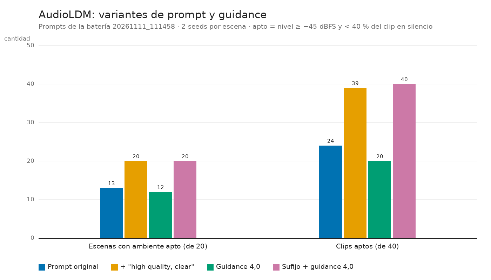

| Variante (20 prompts × 2 seeds) | Escenas aptas | Clips aptos |
|---|---|---|
| Prompt original | 13/20 | 24/40 |
| **+ ", high quality, clear"** | **20/20** | 39/40 |
| Guidance 4,0 | 12/20 | 20/40 |
| Sufijo + guidance 4,0 | 20/20 | 40/40 |

- **Se adoptó el sufijo** y el guidance se mantuvo en 2,5.
- **Validación en la aplicación:** al rehacer el sonido de las historias de ejemplo, las 6 escenas que habían quedado con procedural pasaron a AudioLDM al primer intento.

### 8.6 LLM

| Modelo | Válidas | Tiempo por Story Bible | tok/s | En GPU |
|---|---|---|---|---|
| **Qwen3 4B** | 9/10 | **75 s** | 42,9 | 100 % |
| Qwen3 8B | 9/10 | 982 s | 3,0 | 39 % |

Con 4 GB de VRAM, el 8B no aporta validez y multiplica el tiempo por 13. Los dos perfiles usan el 4B.

## 9. Hardware, versiones, tiempos y reproducibilidad

**Equipo de referencia** (el mismo para desarrollo, pruebas y sustentación):

| Componente | Valor |
|---|---|
| Sistema | Windows 11 Home x64 (build 26200) |
| CPU | Intel Core de 11.ª generación (Tiger Lake-H) |
| RAM | 24 GB |
| GPU | NVIDIA GeForce RTX 3050 Laptop, 4 GB, límite de 75 W; driver 617.42 (CUDA 13.4) |
| Python | 3.12.10 (instalado desde python.org) con `uv` |
| Principales bibliotecas | PyTorch 2.15 (cu132), diffusers ≥ 0.42, Streamlit ≥ 1.50, Pydantic v2, piper-tts, faster-whisper, open-clip-torch, soundfile, pyloudnorm |
| LLM | Ollama 0.40.15 con `qwen3:4b-instruct-2507-q4_K_M` |

**Memoria por etapa** (medida en la batería):
- texto: ~2,5 GB, 100 % en GPU;
- imágenes: 3,16 GB asignados por torch y 4,03 GB reservados;
- sonido: 0,94 GB;
- voz y mezcla: en CPU.

**Tiempos:** unos 2 minutos por historia con el perfil rápido y unos 3 minutos con el de calidad.

**Reproducibilidad:**
- **Seeds:** se derivan de una base fija (1234) y quedan guardadas en `story.json`; las de C1 son aleatorias, pero también quedan registradas.
- **Configuraciones:** las YAML se validan con Pydantic, y cada `manifest.json` guarda la configuración completa.
- **Revisiones de modelos:** el commit de cada repositorio de Hugging Face está en `docs/models_registry.json`.
- **Pasos de Windows:** se repiten con `setup_windows.ps1 -Paso …`. Las evidencias, la batería y las gráficas se regeneran con los scripts de `scripts/`.
- **Historias de ejemplo:** las 3 de `samples/` se abren sin GPU.
- **Pruebas sin GPU:** `uv run pytest` corre en cualquier equipo.

**Ejecución sin conexión:** después de descargar los modelos, la aplicación no necesita Internet:
- `HF_HUB_OFFLINE`, sin telemetría de Streamlit, Ollama en `localhost`;
- `verify_offline.py` bloquea y registra cualquier otra conexión.

## 10. Limitaciones

- **Composición de retrato y clones con IP-Adapter:** la consistencia se paga con menos acción visible. IP-Adapter, además, aplica la identidad del protagonista a otras personas del cuadro.
- **Un solo personaje fijo por historia:** los secundarios no tienen referencia visual propia. Cuando la idea tiene dos protagonistas, el LLM a veces conserva uno ("Un perro y un gato…" terminó con un niño y un gato).
- **Texto de un modelo pequeño:**
  - el 4B tiende a repetir "wind" y "heartbeat" en los prompts de sonido de cualquier género;
  - a veces produce nombres poco naturales ("Kai Kai");
  - falló 1 de cada 10 historias en la tarea 1.4, y la interfaz informa ese caso con un mensaje claro.
- **Métricas indirectas:**
  - CLIP no mide identidad facial ni calidad estética, y premia composiciones repetidas;
  - el control de sonido mide nivel y silencio, pero no si el audio corresponde al prompt (para eso haría falta CLAP);
  - la muestra es de 4 historias por configuración.
- **Stable Audio no evaluado:** exige aceptar su licencia con una cuenta; la comparación de sonido fue AudioLDM frente a procedural.
- **Requiere GPU NVIDIA:** sin ella solo funcionan el modo simulado y las historias de ejemplo.
- **Memoria al límite:** el pico de la GPU completa llega a 4,08 de 4,10 GB, aunque la memoria realmente asignada deja unos 900 MB de margen. Otra aplicación que use la GPU puede provocar falta de memoria.

## 11. Ética, licencias y derechos de voz y audio

- **Transparencia:** la interfaz etiqueta todo el contenido como generado por IA ("Contenido generado por IA (texto, imágenes, voz y sonido), en este equipo"), y el README lo declara.
- **Contenido según el género:**
  - el prompt de cada escena incluye la regla del género: infantil sin violencia ni miedo intenso y con final esperanzador; terror sin gore ni violencia explícita;
  - todas las imágenes llevan un negative prompt común (`nsfw`, `gore`, deformaciones, texto y marcas de agua).
- **Sesgos:**
  - SD 1.5 y DreamShaper heredan los sesgos de sus datos de entrenamiento: estereotipos de edad, género, apariencia y vestuario asociados al rol del personaje o al género del relato.
  - En las pruebas, los protagonistas salieron casi siempre como niños o jóvenes de rostro idealizado, aun en historias de terror.
  - El descriptor fijo del personaje (edad, cabello, ropa) permite controlarlos en parte.
  - Se recomienda revisar las imágenes antes de publicarlas.
- **Derechos de voz:** se usa una voz de Piper publicada para síntesis y no se clona ninguna voz real. XTTS-v2 se descartó también por eso.
- **Licencias:** cada modelo conserva la suya (`MODELS.md`):
  - Qwen3: Apache 2.0;
  - DreamShaper y LCM-LoRA: OpenRAIL;
  - IP-Adapter: Apache 2.0;
  - AudioLDM: CC BY-NC-SA 4.0, solo para uso académico no comercial;
  - Piper: GPL-3.0 para el código, y cada voz según su ficha.

  Los sonidos procedurales son generación propia (MIT). La biblioteca local solo admite clips CC0 (`AUDIO_LICENSES.md`). Por la licencia de AudioLDM, el proyecto es académico y no comercial.
- **Privacidad:** la aplicación no recolecta datos personales ni los envía a terceros. Todo queda en la carpeta local del usuario, y la telemetría de Streamlit está desactivada.
- **Costo computacional:** una historia ocupa la GPU unos 2 minutos. Con el límite de 75 W de la GPU, el consumo estimado es del orden de 3–5 Wh por historia; es una estimación, no una medición. Ejecutar en local evita el costo y la huella de la inferencia en servidores remotos, pero exige hardware propio con GPU.

## 12. Conclusiones, trabajo futuro y referencias

### Conclusiones

1. Es viable generar localmente, con una GPU de 4 GB, un cuento multimodal coherente de 5 escenas en unos 2 minutos. La condición es diseñar el pipeline alrededor de la memoria: un modelo pesado por etapa y voz y mezcla en CPU.
2. La Story Bible validada sirve de contrato entre modalidades. El texto, la imagen y el sonido de cada escena salen de la misma fuente, y los errores del LLM se detectan y reparan antes de llegar a las demás etapas.
3. La consistencia visual se demostró con datos. Story Bible, seed fija e IP-Adapter elevan la similitud entre ilustraciones un 53 % sobre la línea base, en las 4 historias, a cambio de unos 10 s y algo de fidelidad al prompt.
4. Los experimentos cambiaron decisiones:
   - el 8B se descartó por tiempo;
   - LCM se mantuvo frente a 25 pasos;
   - la escala de IP-Adapter se ajustó a 0,4;
   - el sufijo de calidad llevó AudioLDM de 13/20 a 20/20 escenas.
5. Las alternativas automáticas y el `manifest.json` hacen que el sistema sea robusto y trazable. Ninguna escena queda sin imagen ni sonido, y cada decisión del sistema queda registrada.

### Trabajo futuro

- **Escenas con más acción:** escala de IP-Adapter por escena, máscaras del personaje y prompts de encuadre ("wide shot, full body").
- **Varios personajes:** una referencia visual por personaje.
- **Correspondencia audio-texto:** medirla con CLAP y pedir al LLM fuentes sonoras concretas del lugar.
- **Otros modelos:** evaluar Stable Audio 3 Small-SFX con licencia aceptada y Qwen3-0.6B en la comparación de tamaño.
- **Exportación:** el cuento completo en PDF o video.

### Referencias

1. Rombach, R., Blattmann, A., Lorenz, D., Esser, P., y Ommer, B. (2022). High-Resolution Image Synthesis with Latent Diffusion Models. *CVPR 2022*. arXiv:2112.10752.
2. Luo, S., Tan, Y., Huang, L., Li, J., y Zhao, H. (2023). Latent Consistency Models: Synthesizing High-Resolution Images with Few-Step Inference. arXiv:2310.04378.
3. Luo, S., Tan, Y., Patil, S., Gu, D., von Platen, P., Passos, A., Huang, L., Li, J., y Zhao, H. (2023). LCM-LoRA: A Universal Stable-Diffusion Acceleration Module. arXiv:2311.05556.
4. Ye, H., Zhang, J., Liu, S., Han, X., y Yang, W. (2023). IP-Adapter: Text Compatible Image Prompt Adapter for Text-to-Image Diffusion Models. arXiv:2308.06721.
5. Liu, H., Chen, Z., Yuan, Y., Mei, X., Liu, X., Mandic, D., Wang, W., y Plumbley, M. D. (2023). AudioLDM: Text-to-Audio Generation with Latent Diffusion Models. *ICML 2023*. arXiv:2301.12503.
6. Evans, Z., Parker, J. D., Carr, C. J., Zukowski, Z., Taylor, J., y Pons, J. (2024). Stable Audio Open. arXiv:2407.14358.
7. Qwen Team (2025). Qwen3 Technical Report. arXiv:2505.09388.
8. Kim, J., Kong, J., y Son, J. (2021). Conditional Variational Autoencoder with Adversarial Learning for End-to-End Text-to-Speech (VITS). *ICML 2021*. arXiv:2106.06103. Arquitectura en la que se basa Piper.
9. Radford, A., Kim, J. W., Hallacy, C., et al. (2021). Learning Transferable Visual Models From Natural Language Supervision (CLIP). *ICML 2021*. arXiv:2103.00020.
10. Cherti, M., Beaumont, R., Wightman, R., et al. (2023). Reproducible Scaling Laws for Contrastive Language-Image Learning (OpenCLIP, LAION-2B). *CVPR 2023*. arXiv:2212.07143.
11. Hessel, J., Holtzman, A., Forbes, M., Le Bras, R., y Choi, Y. (2021). CLIPScore: A Reference-free Evaluation Metric for Image Captioning. *EMNLP 2021*. arXiv:2104.08718.
12. Radford, A., Kim, J. W., Xu, T., Brockman, G., McLeavey, C., y Sutskever, I. (2023). Robust Speech Recognition via Large-Scale Weak Supervision (Whisper). *ICML 2023*. arXiv:2212.04356.
13. Lu, C., Zhou, Y., Bao, F., Chen, J., Li, C., y Zhu, J. (2022). DPM-Solver++: Fast Solver for Guided Sampling of Diffusion Probabilistic Models. arXiv:2211.01095.
14. Karras, T., Aittala, M., Aila, T., y Laine, S. (2022). Elucidating the Design Space of Diffusion-Based Generative Models. *NeurIPS 2022*. arXiv:2206.00364.
15. ITU-R (2015). Recomendación BS.1770-4: Algorithms to measure audio programme loudness and true-peak audio level.
16. Steinmetz, C. J., y Reiss, J. D. (2021). pyloudnorm: A simple yet flexible loudness meter in Python. *150th AES Convention*.
17. von Platen, P., Patil, S., Lozhkov, A., et al. (2022). Diffusers: State-of-the-art diffusion models. GitHub, <https://github.com/huggingface/diffusers>.
18. Software: Ollama (<https://ollama.com>), Piper (<https://github.com/rhasspy/piper>), Streamlit (<https://streamlit.io>), Pydantic (<https://docs.pydantic.dev>), faster-whisper (<https://github.com/SYSTRAN/faster-whisper>), DreamShaper 8 (<https://huggingface.co/Lykon/dreamshaper-8>).

---

**Anexos en el repositorio:**
- `docs/arquitectura.md`: diagramas y decisiones de diseño;
- `docs/informe/analisis_experimentos.md`: análisis completo;
- `MODELS.md`: modelos, revisiones y mediciones;
- `docs/evidencias/`: salidas de cada prueba;
- `docs/PROGRESO.md`: bitácora;
- `experiments/results.csv`: datos de la batería.

Video demo: `[DATO PENDIENTE]` (tarea 7.3).
