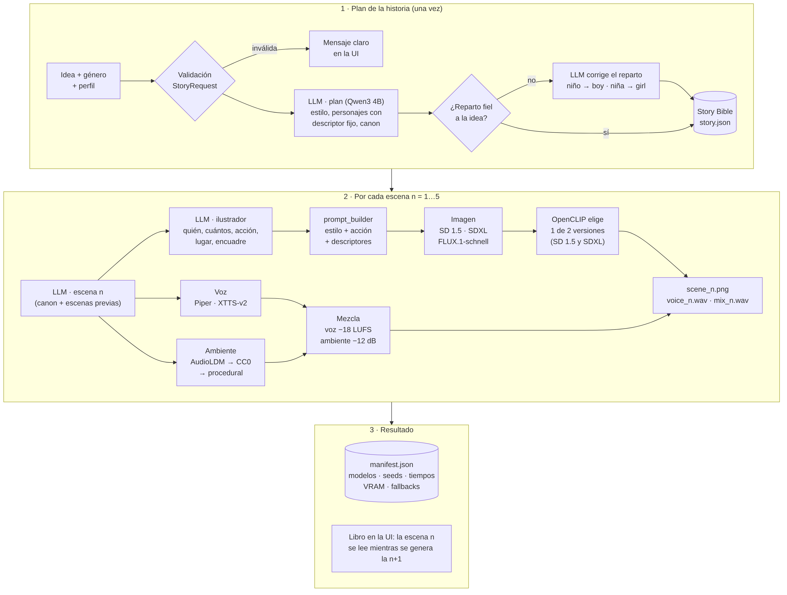
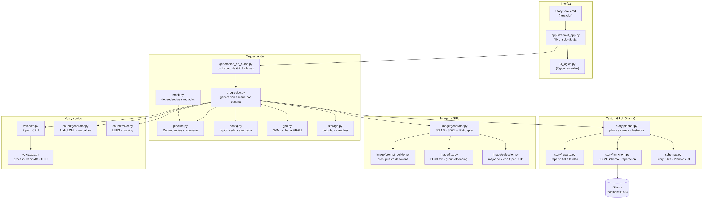
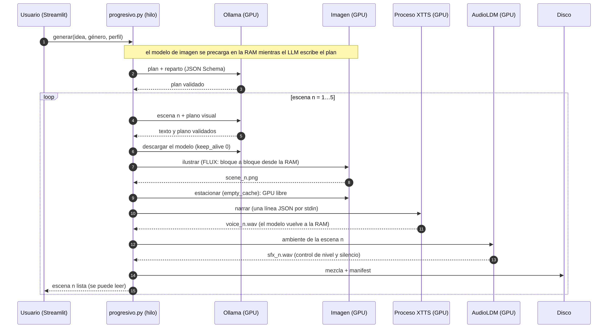
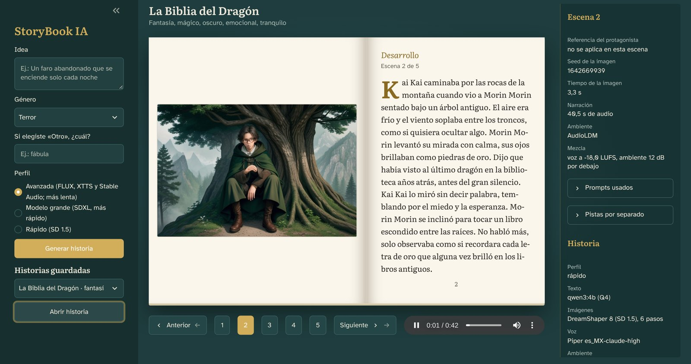
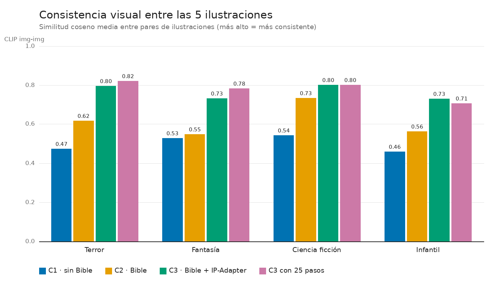
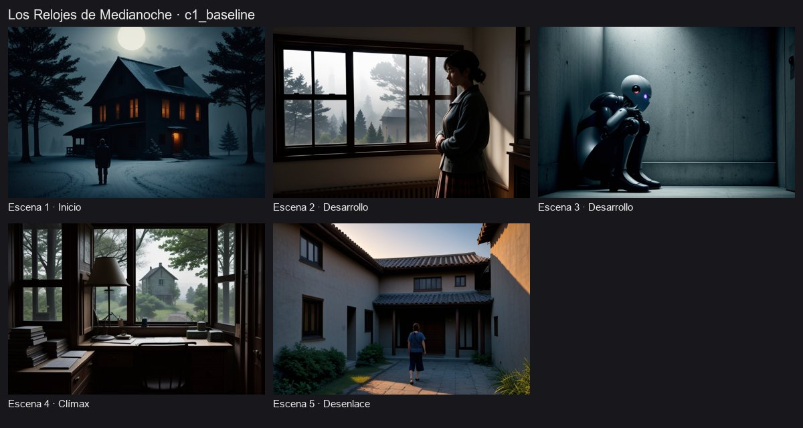
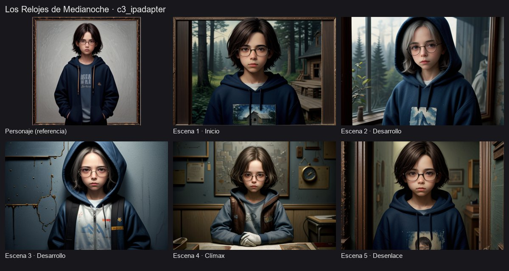
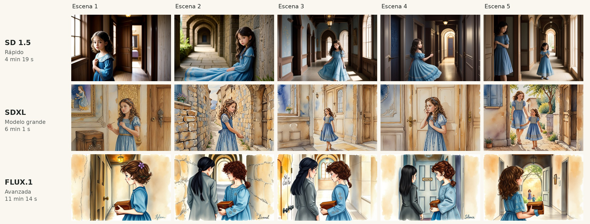
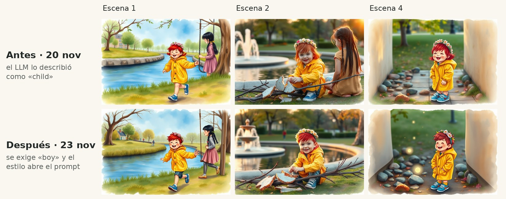
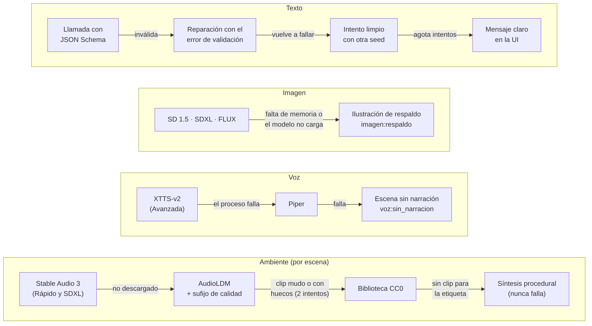

# StoryBook IA

**Generación local de cuentos multimodales de 5 escenas con texto, ilustración, narración y ambiente sonoro**

Documento técnico del proyecto integrador 
Electiva Ingeniería Aplicada – Inteligencia Artificial Generativa (grupo ISS9B) 
Ingeniería de Sistemas · Universidad Santo Tomás, Seccional Tunja

Autor: Diego Alejandro Urbano Pira (código 2386899) 
Docente: Diego Alejandro Vela Beltrán 
Fecha de entrega: 23 de noviembre de 2026 
Repositorio: <https://github.com/DiegoAlejandroU/StoryBook-IA> 
Video demo: <https://youtu.be/Me1E_QfSmLE>

---

## Resumen

StoryBook IA es una aplicación local que convierte una idea breve y un género literario en un cuento ilustrado de exactamente cinco escenas. Cada escena trae texto narrativo en español, una ilustración original, una narración con voz sintética y un ambiente sonoro mezclado bajo la voz.

Todo se genera en un portátil con una GPU de 4 GB (RTX 3050 Laptop) y 24 GB de RAM, sin conexión a Internet y sin servicios de pago.

**Arquitectura:**
- Generación **escena por escena**:
  - el modelo de lenguaje (Qwen3 4B en Ollama) escribe el plan de la historia;
  - luego, por cada escena: el texto, un **plano visual** (qué personajes se ven, cuántos, qué hacen y dónde), la ilustración, la voz, el ambiente y la mezcla;
  - la escena 1 se puede leer mientras se generan las siguientes.
- Una *Story Bible* validada con Pydantic es la única fuente de verdad entre modalidades.
- Tres perfiles de modelos, porque los modelos se turnan en la GPU de 4 GB:
  - **Rápido:** SD 1.5 + LCM + IP-Adapter y voz Piper.
  - **Modelo grande:** SDXL Lightning + IP-Adapter y voz Piper.
  - **Avanzada (por defecto):** FLUX.1-schnell de 12B en fp8 con *group offloading*, y voz XTTS-v2.
  - Los tres usan AudioLDM para el ambiente.

**Resultados:**
- La misma idea generada con los tres perfiles dio la misma historia y tardó:
  - Rápido: 4 min 19 s, con la escena 1 lista a los 92 s;
  - Modelo grande: 6 min 1 s;
  - Avanzada: 11 min 14 s, con la escena 1 a los 191 s.
- Solo FLUX dibujó a la segunda protagonista en las 3 escenas donde aparece (SD 1.5 y SDXL: 0 de 3).
- La Story Bible con seed fija e IP-Adapter eleva la consistencia visual (CLIP img-img) de 0,50 a 0,77 frente a la línea base, en 4 historias.
- Los modelos grandes siguen mejor el texto (CLIP img-texto: SD 1.5 0,282 → SDXL 0,348; SDXL 0,298 → FLUX 0,315).
- La narración tiene un error de palabras del 3,5–4,8 % y no hubo ningún intento de conexión fuera del equipo.

---

## 1. Problema y objetivo

**Problema.** Los sistemas de narración multimodal suelen depender de APIs en la nube: GPT, DALL·E, ElevenLabs. Eso implica costo por uso, envío de datos a terceros y dependencia de la conexión. Producir localmente un cuento coherente en texto, imagen, voz y sonido, con hardware de consumo, tiene tres dificultades:

1. **Memoria:** con 4 GB de VRAM no caben a la vez un LLM, un modelo de difusión y un modelo de audio.
2. **Coherencia entre escenas:** cada imagen se genera de forma independiente, y el personaje tiende a cambiar de cara, ropa o edad.
3. **Coherencia entre modalidades:** el texto, la imagen y el sonido de una escena deben contar lo mismo.

**Objetivo general.** Construir una aplicación local que, a partir de una idea y un género, genere un cuento de exactamente 5 escenas, cada una con:
- texto narrativo en español;
- ilustración original;
- narración con voz sintética;
- ambientación sonora.

Debe usar solo modelos abiertos ejecutados en el equipo y ser reproducible.

**Objetivos específicos:**

1. Diseñar un pipeline que respete el límite de 4 GB de VRAM y termine una historia en menos de 5 minutos con el perfil rápido.
2. Mantener la consistencia visual del protagonista entre escenas y medirla con métricas objetivas (CLIP).
3. Comparar configuraciones de consistencia y modelos de distinto tamaño con datos, y justificar las decisiones con esas mediciones.
4. Garantizar el funcionamiento sin conexión y con alternativas automáticas (*fallbacks*) cuando un modelo falle.
5. Entregar un repositorio reproducible con interfaz gráfica, pruebas automatizadas, evidencias y documentación.

## 2. Arquitectura y flujo de datos

El sistema genera la historia **escena por escena** (`src/storybook/progresivo.py`).

- **Una sola fuente de verdad:** la *Story Bible*, un JSON validado con Pydantic v2 que genera el LLM.
- **De ella sale todo:** el texto de cada escena, el plano visual y el prompt de cada ilustración (estilo + acción + descriptor fijo de los personajes), y el prompt de cada ambiente sonoro.
- **Un modelo pesado en la GPU a la vez:**
  - el LLM se descarga después de cada llamada (`keep_alive` 0);
  - la imagen suelta la GPU antes de la voz;
  - XTTS sube a la GPU solo mientras narra.
- **Generación progresiva:** cada escena se guarda y se muestra apenas está completa. Un solo trabajo de GPU corre a la vez (`generacion_en_curso.py`), en un hilo aparte de la interfaz.

| Etapa | Recurso | Modelo o técnica | Salida |
|---|---|---|---|
| 1. Validación de la entrada | CPU | Pydantic (`StoryRequest`) | Idea, género y perfil validados |
| 2. Plan | GPU (Ollama) | Qwen3 4B; verificación del reparto contra la idea | Plan de la Story Bible |
| 3. Texto de la escena n | GPU (Ollama) | Qwen3 4B (ve el canon y las escenas previas) | Escena n de `story.json` |
| 4. Ilustrador de la escena n | GPU (Ollama) | Qwen3 4B → `PlanoVisual` | Quién se ve, cuántos, acción, lugar y encuadre |
| 5. Imagen | GPU | SD 1.5 · SDXL · FLUX.1-schnell, según el perfil | `scene_n.png` |
| 6. Voz | CPU o GPU | Piper (CPU) · XTTS-v2 (GPU, proceso aparte) | `voice_n.wav` |
| 7. Sonido | GPU → CPU | AudioLDM → biblioteca CC0 → procedural | `sfx_n.wav` |
| 8. Mezcla | CPU | Normalización LUFS y *ducking* | `ambience_n.wav`, `mix_n.wav` |
| 9. Persistencia | Disco | `storage.py` | `manifest.json` y la carpeta de la historia |
| 10. Interfaz | Navegador local | Streamlit | Libro: imagen, texto, reproductor y detalles técnicos |

El paso de la GPU entre modelos se ve en la secuencia de una generación:

**Diseño para pruebas.** Las dependencias pesadas (Ollama, diffusers, Piper, XTTS) se inyectan (`Dependencias`), y `storybook.mock` las reemplaza por dobles simulados. Así, la interfaz y el pipeline completo se prueban sin GPU: 431 pruebas automatizadas corren en Linux sin torch. La interfaz (`app/streamlit_app.py`) solo dibuja; su lógica está en `ui_logica.py` y también tiene pruebas.

El detalle de módulos, decisiones y diagramas está en `docs/arquitectura.md`.

## 3. Tecnologías y modelos

La restricción que domina todas las decisiones es la GPU de 4 GB (RTX 3050 Laptop, 75 W). También hay 24 GB de RAM y la obligación de funcionar sin conexión.

**Perfiles** (`configs/`; Avanzada es el perfil por defecto de la aplicación):

| | Rápido (`rapido`) | Modelo grande (`sdxl`) | Avanzada (`avanzada`) |
|---|---|---|---|
| Texto | Qwen3 4B | Qwen3 4B | Qwen3 4B |
| Imagen | DreamShaper 8 (SD 1.5) + LCM-LoRA, 6 pasos, 768 × 512 | DreamShaper XL Lightning (SDXL), 6 pasos, 1152 × 768, UNet en fp8 | FLUX.1-schnell (12B), 4 pasos, 1056 × 704, pesos en fp8 |
| Consistencia | IP-Adapter 0,4 + seed fija | IP-Adapter 0,4 + seed fija | Seed fija y descriptor completo leído por T5 |
| Versiones por imagen | 2, elige OpenCLIP | 2, elige OpenCLIP | 1 |
| Voz | Piper `es_MX-claude-high` (CPU) | Piper (CPU) | XTTS-v2, voz incluida "Ana Florence" (GPU) |
| Ambiente | SA3 → AudioLDM → CC0 → procedural | Igual que Rápido | AudioLDM → CC0 → procedural |

**Por qué cada modelo:**

| Modalidad | Modelo | Por qué, dada la restricción de 4 GB |
|---|---|---|
| Texto | **Qwen3-4B-Instruct-2507** (Q4_K_M, ~2,5 GB) vía Ollama | Cabe completo en la GPU con `num_ctx` 4096 (43 tok/s). Genera JSON estructurado en español con salida guiada por JSON Schema. Licencia Apache 2.0. |
| Imagen, Rápido | **DreamShaper 8** (SD 1.5) + **LCM-LoRA** | SD 1.5 en fp16 cabe en ~3,2 GB. LCM reduce el muestreo a 6 pasos (~4,5 s por versión). |
| Imagen, Modelo grande | **DreamShaper XL Lightning** (SDXL) | Pedido del docente (12 nov): un modelo más grande. La UNet de 2,6B en fp8 con *offload* cabe en 4 GB; la destilación Lightning permite 6 pasos (~11–17 s por versión). |
| Imagen, Avanzada | **FLUX.1-schnell** (12B, Apache 2.0) | Sigue mucho mejor un prompt largo porque lee el texto con T5-XXL (hasta 256 tokens). Está destilado para 4 pasos sin CFG. No cabe ni en fp16; se adaptó a 4 GB como se explica abajo (54–79 s por imagen). |
| Consistencia | **IP-Adapter** (SD 1.5 y SDXL, escala 0,4) | Condiciona cada escena con una *character sheet* del protagonista, sin entrenar nada. Para FLUX no hay un IP-Adapter oficial. |
| Selección | **OpenCLIP ViT-B-32** | Elige la mejor de 2 versiones según lo que debe verse en la escena. |
| Voz, Rápido y Modelo grande | **Piper** `es_MX-claude-high` | Corre en CPU en tiempo real (RTF 0,03), así que no compite por la VRAM. |
| Voz, Avanzada | **XTTS-v2** (Coqui, licencia CPML) | Voz mucho más natural. Corre en su propio entorno (`.venv-xtts`, torch 2.11), porque necesita `torchaudio`, que no existe para la versión de torch de la app (2.15). Narra ~45 s de audio en ~30 s. |
| Sonido | **AudioLDM** s-full (421 M) | Text-to-audio en ~0,9 GB y ~2 s por clip de 8 s. No exige token. |
| Sonido (respaldo) | Biblioteca CC0 y **síntesis procedural** propia (numpy/scipy) | Garantizan que siempre haya ambiente, aunque falle el modelo generativo. |
| Evaluación | OpenCLIP ViT-B-32 y faster-whisper small (int8) | Corren en CPU, solo para medir. |

**FLUX.1-schnell en 4 GB** (`src/storybook/image/flux.py`):
1. **Copia local en fp8:** `scripts/convertir_flux_fp8.py` convierte los pesos oficiales en bf16 del transformer y de T5 a fp8 (e4m3). El resultado son ~19 GB en disco, que viven en la RAM. Cada capa se calcula en bf16 (*layerwise casting*).
2. **Group offloading por bloques:** cada bloque del transformer sube a la GPU solo mientras calcula. Con *streams* de CUDA, la copia del bloque siguiente se solapa con el cálculo del actual.
3. **T5 por imagen:** el codificador de texto se carga solo para leer el prompt y se libera antes de dibujar, lo que ahorra unos 5 GB de RAM. CLIP-L y el VAE suben a la GPU solo en su llamada.
4. **Medido:** 53 s por imagen fuera de la app y 54–79 s dentro. Pico de RAM del proceso: 17,95 GB de 24.

**Alternativas descartadas o retiradas:**

| Alternativa | Motivo |
|---|---|
| Qwen3 8B | Medido en la tarea 1.4: la misma validez (9/10) que el 4B, pero 13 veces más lento (~16 min por historia), con el 61 % del modelo en CPU. |
| FLUX.1-dev | Licencia no comercial y ~30–50 pasos: minutos por imagen en este equipo. |
| Stable Audio Open 1.0 | Estuvo primero en la cadena de Avanzada (18–20 nov): tardaba 35–57 s por escena para 8 s de ambiente, casi una cuarta parte de la historia. Se retiró el 23 nov; sigue descargado. |
| Stable Audio 3 Small-SFX | Exige aceptar su licencia; no está descargado. La cadena pasa sola a AudioLDM y lo registra como alternativa. |
| MusicGen | El enunciado pide ambientes y efectos, no música; su licencia es CC BY-NC. |
| Safety checker de SD | Ocupa ~600 MB de VRAM; se sustituye por prompts negativos, reglas por género y revisión humana. |
| Gradio | Streamlit da estado de sesión y actualización periódica con menos código de interfaz. |

Las revisiones exactas, las licencias y las mediciones por modelo están en `MODELS.md` y `docs/models_registry.json`.

## 4. Procedimiento de generación de las 5 escenas

1. **Entrada:** idea (hasta 500 caracteres), género y perfil. El género es uno de terror, fantasía, misterio, aventura, ciencia ficción, infantil u "otro" con texto libre. La entrada se valida antes de usar la GPU.
2. **Plan (1 llamada al LLM):** título, tono, estilo visual (técnica, paleta, iluminación), escenario, personajes y canon inicial.
   - Cada personaje tiene un descriptor visual fijo en inglés.
   - La salida está restringida por un JSON Schema generado desde Pydantic.
   - Mientras el LLM escribe el plan, el modelo de imagen se precarga en la RAM.
3. **Reparto fiel a la idea** (`story/reparto.py`):
   - Si la idea nombra personas o animales que faltan en el reparto, o el reparto trae animales que la idea no pide, se devuelve al LLM para corregirlo.
   - "Un niño" exige un personaje *boy* y "una niña", *girl*. Si el LLM puso el genérico *child*, el código lo precisa sin otra llamada.
4. **Escena n (1 llamada):** recibe el plan, los resúmenes de las escenas anteriores, el canon acumulado y la regla del género (por ejemplo, infantil: "sin violencia ni miedo intenso, final esperanzador").
   - Produce la fase, el texto narrativo en español (90–160 palabras), un resumen, los personajes presentes, hechos nuevos, `prompt_imagen` y `prompt_sonido` (en inglés) y etiquetas de sonido.
   - Las fases son inicio, desarrollo, desarrollo, clímax y desenlace.
5. **Ilustrador (1 llamada):** el LLM describe el plano visual de la escena: personaje principal, acompañantes con su cantidad (*one*, *two*, *many*), acción, lugar y encuadre.
   - El código traduce los nombres a los ids del reparto.
   - Descarta las figuras sin nombre que la escena no menciona.
6. **Validación y reparación:**
   - El esquema rechaza los campos en el idioma equivocado, los ids inexistentes, más de un protagonista y los prompts que exceden el presupuesto de tokens.
   - El error de validación se devuelve al modelo para que repare su respuesta. Si la reparación falla, el intento siguiente empieza de cero con otra seed.
   - En la generación por escenas no corre el auditor final de coherencia, porque las primeras escenas ya se están leyendo. La coherencia se apoya en el canon acumulado que ve cada escena.
7. **Imagen:**
   - **Prompt** (`prompt_builder`): técnica del estilo + plano + acción + descriptor completo del personaje principal + rasgos de los acompañantes + paleta e iluminación.
   - **Presupuesto de tokens:** en SD 1.5 y SDXL se verifica con el tokenizer el límite de 77 tokens de CLIP. FLUX lee hasta 256 tokens con T5.
   - **SD 1.5 y SDXL:** antes de las escenas se genera la *character sheet* del protagonista para el IP-Adapter. Por escena se generan 2 versiones y OpenCLIP elige la que mejor muestra lo que debe verse; penaliza lo que debe evitarse, por ejemplo "two boys" si solo hay uno.
   - **Seed:** fija y compartida.
8. **Voz:** una sola voz y parámetros constantes para las 5 narraciones.
   - XTTS divide el texto en fragmentos de hasta 220 caracteres y los une con pausas de 0,18 s.
   - Si el proceso de XTTS falla, la escena se narra con Piper.
9. **Sonido:** cada `prompt_sonido` se limpia (se quitan adjetivos de intensidad baja como "soft" y menciones de silencio) y se le agrega ", high quality, clear".
   - Un control descarta los clips de menos de −45 dBFS o con más del 40 % del tiempo en silencio.
   - Si un clip falla, se reintenta con otra seed y luego se pasa al siguiente backend: biblioteca y después síntesis procedural.
10. **Mezcla:**
    - El ambiente se ajusta a la duración de la voz (bucle con fundido cruzado).
    - Se normaliza: voz a −18 LUFS y ambiente 12 dB por debajo, con *ducking* de 6 dB mientras se habla.
11. **Persistencia:** cada escena queda en `outputs/<run_id>/` apenas está lista, con un `manifest.json` que se escribe incluso si algo falla. La historia se reabre sin regenerarla, y cada escena se puede regenerar sola desde la interfaz.

## 5. Estrategia de consistencia

La consistencia se trabaja en tres niveles.

**Narrativa:**
- La Story Bible fija los personajes, sus rasgos y el canon.
- Cada escena se escribe viendo el canon acumulado y los resúmenes previos.
- El reparto se verifica contra la idea antes de escribir las escenas.

**Visual (siete capas):**
1. **Story Bible en el prompt:** el estilo visual y el descriptor fijo de cada personaje se repiten, idénticos, en las 5 escenas.
2. **Seed fija y compartida:** `consistency.py` deriva las seeds de una base (1234), para que el ruido inicial no varíe entre escenas.
3. **IP-Adapter 0,4** (SD 1.5 y SDXL): usa la *character sheet* como referencia de identidad. La escala se eligió en la tarea 2.3:
   - con 0,6, todas las escenas eran retratos de frente;
   - con 0,25, a veces desaparecía el protagonista.
4. **Ilustrador:** dice quién aparece y cuántos, para que no sobren ni falten personajes.
5. **Mejor de 2 versiones con OpenCLIP** (SD 1.5 y SDXL): elige la imagen que muestra a todos los que deben verse.
6. **Personaje foco:** solo el personaje principal lleva el descriptor completo; los acompañantes llevan dos rasgos entre paréntesis, para que el modelo no mezcle sus rasgos.
7. **Estilo al principio en FLUX:** la técnica (por ejemplo, "watercolor with fine linework") abre el prompt. Así no salen escenas fotográficas en una historia en acuarela.

**Entre modalidades:**
- El texto, el plano visual y el prompt de sonido de una escena salen de la misma entrada de la Bible.
- La voz y el ambiente se mezclan con niveles fijos, para que el sonido acompañe sin tapar la narración.

La sección 8 cuantifica el aporte de cada capa.

## 6. Configuraciones y experimentos

**Perfiles de uso** (`configs/`): `rapido`, `sdxl` y `avanzada` (sección 3), más `calidad` (SD 1.5 con DPM++ 2M Karras de 25 pasos), usado en la batería.

**Configuraciones experimentales de consistencia** (`configs/experiments/`):

| Id | Story Bible | Seed | IP-Adapter | Muestreo |
|---|---|---|---|---|
| C1 `c1_baseline` | No: solo el `prompt_imagen` de la escena | Aleatoria por escena | No | LCM, 6 pasos |
| C2 `c2_bible` | Sí | Fija y compartida | No | LCM, 6 pasos |
| C3 `c3_ipadapter` (producción) | Sí | Fija y compartida | Sí, 0,4 | LCM, 6 pasos |
| `calidad` | Sí | Fija y compartida | Sí, 0,4 | DPM++ 2M Karras, 25 pasos |
| `llm_8b` | — | — | — | Qwen3 8B en vez del 4B |

**Experimentos:**
- **Batería de consistencia** (`scripts/run_experiment.py`, tarea 6.2):
  - 4 ideas, una por género: terror, fantasía, ciencia ficción e infantil.
  - Para cada idea, la historia se genera con C3 y, con la misma Story Bible, se regeneran las imágenes con C1, C2 y `calidad`.
- **LLM 4B frente a 8B** (tarea 1.4): 10 historias con cada modelo.
- **Variantes de prompt y guidance para AudioLDM:** 20 prompts × 4 variantes × 2 seeds.
- **Modelo de imagen más grande** (`scripts/f7_sdxl_prueba.py`): una historia guardada se ilustra otra vez con otro perfil, con el mismo texto y las mismas seeds.
  - 13 nov: SD 1.5 frente a SDXL.
  - 17 nov: el ilustrador.
  - 19 nov: SDXL frente a FLUX.
- **La misma idea con los tres perfiles** (23 nov): "Una chica en un edificio está en un pasillo con demasiadas puertas" (fantasía), generada completa en la aplicación con cada perfil.

**Métricas:**
- **CLIP img-img:** similitud coseno media entre los 10 pares de ilustraciones de una historia. Mide la consistencia.
- **CLIP img-texto:** similitud entre cada ilustración y su prompt efectivo. Mide la pertinencia.
- **WER:** error de palabras de Whisper small sobre la narración. Mide la inteligibilidad.
- **Tiempo por etapa, VRAM y RAM:** con NVML, torch y psutil.
- **Nivel y silencio de los clips de sonido.**
- **Conteos verificables:** en cuántas escenas aparece cada personaje u objeto que el texto pide.

## 7. Evidencias de pruebas

Cada prueba en el equipo de referencia se ejecutó con `scripts/setup_windows.ps1` o desde la aplicación, que guardan la salida en `docs/evidencias/`. Cada una tiene su entrada en la bitácora de `docs/PROGRESO.md`.

| Fecha | Prueba | Resultado | Evidencia |
|---|---|---|---|
| 9–10 nov | Entorno: CUDA, torch, descarga de modelos y diagnóstico | Todo en verde; modelos registrados con su revisión | `check_env.txt`, `download_models.txt`, `docs/models_registry.json` |
| 10 nov | F1: 10 Story Bibles con el 4B y 10 con el 8B | 4B: 9/10 válidas en 75 s. 8B: 9/10 en 982 s. | `f1_resumen.md`, `f1_resumen_calidad.md` |
| 10 nov | F2: imágenes reales y variantes de IP-Adapter | IP 0,4 + `accion_primero` elegido | `f2_f3_resumen.md`, `f2_variantes.md` |
| 10 nov | F3: 3 voces de Piper con WER | WER de 4,7 % a 8,3 % (mediana); voz elegida al escucharlas | `f2_f3_resumen.md` |
| 10 nov | F4: sonido y mezcla | AudioLDM en las 5 escenas; voz −18 LUFS | `f4_sonido.md` |
| 10 nov | F5: verificación sin conexión, con el Wi-Fi apagado | 3 historias completas, **0 conexiones externas** | `verify_offline.txt` |
| 11 nov | F6: batería C1/C2/C3/calidad × 4 géneros | 16/16 pruebas con 5 escenas (sección 8) | `f6_experimentos_20261111_111458.md`, `f6_hojas/` |
| 11 nov | F6: variantes de prompt de AudioLDM | 20/20 escenas aptas con el sufijo de calidad | `f6_audioldm_prompts.md` |
| 13 nov | F7: SD 1.5 frente a SDXL, misma historia | SDXL: pertinencia 0,348 frente a 0,282; 10,9 s por imagen | `f7_sdxl.md`, `f7_hojas/` |
| 17 nov | F9: ilustrador y mejor de 2 versiones (SDXL) | Pertinencia 0,349 → 0,378 en la historia del perro y los gatos | `f9_ilustrador.md`, `f9_ilustrador_hojas/` |
| 19 nov | F10: SDXL frente a FLUX.1-schnell, misma historia | FLUX: pertinencia 0,315 frente a 0,298; 53 s por imagen; RAM pico 17,95 GB | `f10_avanzada.md`, `f10_avanzada_hojas/` |
| 20 nov | Voz XTTS-v2 en la GPU | Carga 20,8 s; 18–26 s por escena para 38–54 s de audio | `f10_voz.md`, `f10_audio/` |
| 20–23 nov | Historias completas con Avanzada en la aplicación | De 14 min 54 s a 11 min 14 s después de retirar Stable Audio y liberar la GPU antes de la voz | `outputs/` y bitácora de `PROGRESO.md` |
| 23 nov | La misma idea con los tres perfiles | Tabla de la sección 8.8 | `docs/presentacion/` |
| Continuo | Pruebas automatizadas (pytest) y lint (ruff) | 431 pruebas en verde, sin GPU ni red | `pytest.txt` |

**Revisión manual de la comparación del 23 nov** (conteos hechos por el autor sobre las 15 ilustraciones):

| Criterio | Rápido (SD 1.5) | Modelo grande (SDXL) | Avanzada (FLUX) |
|---|---|---|---|
| Historia completa con 5 escenas | Sí (aviso: SA3 no descargado) | Sí (aviso: SA3 no descargado) | Sí, sin alternativas |
| Luna (protagonista) en las 5 escenas | 5/5 | 5/5 | 5/5 |
| Sara en las escenas 2–4, donde aparece | 0/3 | 0/3 | 3/3 |
| La caja de madera de Luna | 0/5 | 1/5 | 5/5 |
| Protagonista duplicada | Escena 5 | Escena 5 | Ninguna |
| Estilo pedido (acuarela) | 0/5 (fotográfico) | 5/5 | 5/5 |
| Narración | Piper | Piper | XTTS-v2 |

## 8. Resultados y análisis

El análisis de la batería está en `docs/informe/analisis_experimentos.md`. Aquí se resumen los hallazgos.

### 8.1 Consistencia visual (batería con SD 1.5)

| Configuración | CLIP img-img (media) | Peor par | CLIP img-texto | Imágenes por historia |
|---|---|---|---|---|
| C1 · sin Bible | 0,501 | 0,326 | 0,343 | 17,2 s |
| C2 · Bible | 0,616 | 0,382 | 0,335 | 17,2 s |
| **C3 · Bible + IP-Adapter** | **0,765** | **0,618** | 0,319 | 27,1 s |
| C3 con 25 pasos | 0,778 | 0,614 | 0,347 | 54,9 s |

- **El orden C3 > C2 > C1 se cumple en las 4 historias.**
  - La Story Bible por sí sola aporta +0,115 (+23 %).
  - El IP-Adapter aporta +0,149 adicional (+24 %).
  - En conjunto, +53 % sobre la línea base.
- **El peor par sube de 0,33 a 0,62.** Sin IP-Adapter siempre hay al menos una escena con otro personaje. En C1, en la historia de terror, el protagonista llega a convertirse en un robot.

| C1 · sin Bible (terror) | C3 · Bible + IP-Adapter (terror) |
|---|---|
|  |  |

### 8.2 El costo de la consistencia

- **Tiempo:** el IP-Adapter suma unos 10 s por historia.
- **Fidelidad al prompt:** CLIP img-texto baja de 0,343 a 0,319. La referencia del personaje compite con el texto de la escena.
- **Composición:** C3 tiende a mostrar al protagonista de frente, como un retrato, y con poca acción.
- **Matiz sobre la métrica:** parte del CLIP img-img alto de C3 se debe a esa composición repetida y no solo a la identidad del personaje.

### 8.3 LCM frente a DPM++ 25 pasos

Con 25 pasos, la consistencia es prácticamente igual (+0,013) y la pertinencia algo mayor (+0,028), pero tarda el doble (55 frente a 27 s). Por eso el perfil Rápido usa LCM con 6 pasos.

### 8.4 Tiempos con el perfil Rápido y narración

- **Una historia completa tardaba entre 124 y 129 s** en la batería del 11 nov, con generación de una sola vez. Hoy, por escenas y con 2 versiones por imagen, tarda 4 min 19 s, pero la escena 1 se lee a los 92 s.
- **La narración se entiende bien:** WER de 3,5 a 4,8 %; los errores se concentran en nombres propios inventados.

### 8.5 Sonido generativo

| Variante (20 prompts × 2 seeds) | Escenas aptas | Clips aptos |
|---|---|---|
| Prompt original | 13/20 | 24/40 |
| **+ ", high quality, clear"** | **20/20** | 39/40 |
| Guidance 4,0 | 12/20 | 20/40 |
| Sufijo + guidance 4,0 | 20/20 | 40/40 |

Los prompts que fallaban describían fuentes tenues ("wind rustling through trees"), con clips de −47 a −75 dBFS. Se adoptó el sufijo y el guidance se mantuvo en 2,5.

### 8.6 LLM

| Modelo | Válidas | Tiempo por Story Bible | tok/s | En GPU |
|---|---|---|---|---|
| **Qwen3 4B** | 9/10 | **75 s** | 42,9 | 100 % |
| Qwen3 8B | 9/10 | 982 s | 3,0 | 39 % |

Con 4 GB de VRAM, el 8B no aporta validez y multiplica el tiempo por 13.

### 8.7 Modelos de imagen más grandes

Cada comparación ilustra otra vez una misma historia guardada, con el mismo texto y las mismas seeds:

| Comparación | Perfil | Por imagen | CLIP img-texto (pertinencia) | CLIP img-img (consistencia) |
|---|---|---|---|---|
| "El Río Olvidado" (13 nov) | SD 1.5 | 3,6 s | 0,282 | 0,734 |
| | SDXL | 10,9 s | **0,348** | 0,658 |
| "El Respiro de la Sabana" (19 nov) | SDXL | 11,1 s | 0,298 | **0,845** |
| | FLUX.1-schnell | 53,3 s | **0,315** | 0,763 |

- **Pertinencia:** sube con el tamaño del modelo: +23 % de SD 1.5 a SDXL y +6 % de SDXL a FLUX.
- **Consistencia:** baja algo en FLUX, porque no tiene IP-Adapter y varía más la composición entre escenas.
- **El ilustrador y el personaje foco** (17 nov) subieron la pertinencia de SDXL de 0,349 a 0,378 y la consistencia de 0,744 a 0,768, en una historia con un perro rodeado de gatos.

### 8.8 La misma historia con los tres perfiles (23 nov)

Con la misma idea y el mismo género, el LLM escribió la misma historia en los tres perfiles: "Las Puertas Olvidadas", con Luna (niña de vestido azul, con una caja de madera) y Sara (mujer de abrigo gris).

| Perfil | Escena 1 lista | Historia completa | Imagen por escena | Voz por escena | Ambiente por escena |
|---|---|---|---|---|---|
| Rápido (SD 1.5) | 92 s | 259 s (4 min 19 s) | ~10 s (2 versiones) | 1,3–3,1 s | 1,6–1,9 s |
| Modelo grande (SDXL) | 98 s | 361 s (6 min 1 s) | ~30 s (2 versiones) | 1,3–1,9 s | 1,6–2,0 s |
| Avanzada (FLUX) | 191 s | 674 s (11 min 14 s) | 54–79 s (1 versión) | 27–34 s | 2,0–2,9 s |

- **Solo FLUX dibuja a Sara** en las escenas 2–4, y la caja de Luna en las 5 (sección 7).
- **FLUX también escribe en la imagen el texto que pide la acción:** los letreros "Sol, Cielo, Mar" y "Silence" en las puertas.
- **SD 1.5 se acerca a una foto;** SDXL y FLUX respetan la acuarela.
- **El texto del LLM pesa igual en los tres perfiles:** unos 2,5 minutos por historia (146–160 s), con reintentos cuando el 4B escribe `prompt_imagen` en español.

### 8.9 Optimización del perfil Avanzada

| Fecha | Historia | Cambio | Historia completa |
|---|---|---|---|
| 20 nov | "Un avión cayendo hacia un edificio" | FLUX + XTTS + Stable Audio Open | 894 s (14 min 54 s) |
| 23 nov | "Un niño en un parque infantil" | Sin Stable Audio (AudioLDM) | 845 s (14 min 5 s) |
| 23 nov | "Una chica en un edificio…" | Además, la imagen libera la GPU antes de la voz | 674 s (11 min 14 s) |

- **Stable Audio Open** tardaba 35–57 s por escena para 8 s de ambiente; AudioLDM tarda ~2 s.
- **Después de la imagen, la GPU seguía ocupada:** quedaban 4,05 de 4,10 GB en la caché de torch, y XTTS, en otro proceso, narraba con memoria compartida.
  - Antes: 66–76 s por escena, en vez de ~30 s.
  - Liberarla antes de la voz dejó la voz en 27–34 s y el ambiente en 2–3 s en todas las escenas.

## 9. Hardware, versiones, tiempos y reproducibilidad

**Equipo de referencia** (el mismo para desarrollo, pruebas y sustentación):

| Componente | Valor |
|---|---|
| Sistema | Windows 11 Home x64 (build 26200) |
| CPU | Intel Core i5-11400H, 6 núcleos / 12 hilos, 2,7 GHz |
| RAM | 24 GB |
| GPU | NVIDIA GeForce RTX 3050 Laptop, 4 GB, límite de 75 W; driver 617.42 (CUDA 13.4) |
| Python | 3.12.10 (instalado desde python.org) con `uv` |
| Bibliotecas de la app | torch 2.15.0+cu132, torchvision 0.29.2, diffusers 0.42.1, transformers 5.22.2, accelerate 1.15.0, peft 0.21.2, safetensors 0.8.0, Streamlit ≥ 1.50, Pydantic v2, piper-tts 1.8.0, open-clip-torch, faster-whisper, soundfile, pyloudnorm, torchsde |
| Entorno de XTTS (`.venv-xtts`) | torch 2.11 + torchaudio 2.11, coqui-tts 0.28.0 |
| LLM | Ollama 0.40.16 con `qwen3:4b-instruct-2507-q4_K_M` |

**Memoria:**
- Texto: ~2,5 GB, 100 % en la GPU; se descarga después de cada llamada.
- SD 1.5: 3,16 GB asignados por torch. SDXL: 3,48 GB asignados; proceso de 12,3 GB en RAM.
- FLUX: 2,08 GB asignados en la GPU; proceso de hasta 17,95 GB en RAM, con la RAM libre en el mínimo (0,01 GB). Por eso conviene cerrar otros programas al usar Avanzada.
- XTTS: ~1,8 GB, en la GPU solo mientras narra. AudioLDM: 0,94 GB.

**Disco** (modelos en `models/`):
- Rápido: ~10 GB, incluidos Qwen3 4B, AudioLDM, Piper y los modelos de evaluación.
- Modelo grande: ~7 GB más.
- Avanzada: ~53 GB más (FLUX oficial 32 GB, su copia fp8 19 GB y XTTS 1,8 GB).

**Tiempos por historia** (equipo de referencia, 23 nov): Rápido ~4 min, Modelo grande ~6 min y Avanzada ~11 min (sección 8.8).

**Reproducibilidad:**
- **Seeds:** se derivan de una base fija (1234) y quedan guardadas en `story.json`. Con el mismo LLM, la misma idea da la misma historia (sección 8.8).
- **Configuraciones:** las YAML se validan con Pydantic, y cada `manifest.json` guarda la configuración completa, las versiones y el hardware.
- **Revisiones de modelos:** el commit de cada repositorio de Hugging Face está en `docs/models_registry.json`.
- **Pasos de Windows:** se repiten con `setup_windows.ps1 -Paso …` (`modelos`, `avanzada`, `xtts`, `experimentos`, `git`…).
- **Historias de ejemplo:** las de `samples/` se abren sin GPU.
- **Pruebas sin GPU:** `uv run pytest` corre en cualquier equipo.

**Ejecución sin conexión:** después de descargar los modelos, la aplicación no necesita Internet:
- `HF_HUB_OFFLINE`, sin telemetría de Streamlit, Ollama en `localhost`;
- el proceso de XTTS también arranca con `HF_HUB_OFFLINE`;
- `verify_offline.py` bloquea y registra cualquier otra conexión.

## 10. Limitaciones

- **Tiempo del perfil Avanzada:** ~11 min por historia y ~3 min hasta la escena 1. Con 4 GB, FLUX copia sus bloques desde la RAM en cada paso.
- **RAM al límite con Avanzada:** el proceso llega a ~18 GB de 24. Con otros programas abiertos, Windows usa el disco como memoria y el equipo se pone lento, aunque la historia termina.
- **Sin referencia de identidad en FLUX:** no hay IP-Adapter oficial; la consistencia depende del descriptor y baja algo frente a SDXL (0,763 frente a 0,845).
- **Texto inventado en las imágenes de FLUX:** a veces dibuja firmas o letreros que nadie pidió ("Lylan", "Livered").
- **Composición de retrato y clones con IP-Adapter** en SD 1.5 y SDXL: la consistencia se paga con menos acción visible.
- **Texto de un modelo pequeño:**
  - a veces escribe `prompt_imagen` en español; el esquema lo rechaza y la escena se reintenta (~13 s);
  - a veces agrega en el texto un personaje que no está en el reparto (por ejemplo, "Milo"); el ilustrador no lo dibuja;
  - tiende a repetir "wind" y "heartbeat" en los prompts de sonido.
- **Métricas indirectas:**
  - CLIP no mide identidad facial ni calidad estética, y premia composiciones repetidas;
  - el control de sonido mide nivel y silencio, pero no si el audio corresponde al prompt (para eso haría falta CLAP);
  - la muestra es de pocas historias por configuración, en un solo equipo.
- **Aviso en Rápido y Modelo grande:** Stable Audio 3 no está descargado. La cadena pasa a AudioLDM y la historia queda como "completa con respaldos".
- **Requiere GPU NVIDIA:** sin ella solo funcionan el modo simulado y las historias de ejemplo.

## 11. Ética, licencias y derechos de voz y audio

- **Transparencia:** la interfaz etiqueta todo el contenido como generado por IA ("Contenido generado por IA (texto, imágenes, voz y sonido), en este equipo"), y el README lo declara.
- **Contenido según el género:**
  - el prompt de cada escena incluye la regla del género: infantil sin violencia ni miedo intenso y con final esperanzador; terror sin gore ni violencia explícita;
  - SD 1.5 y SDXL llevan un negative prompt común (`nsfw`, `gore`, deformaciones, texto y marcas de agua). FLUX.1-schnell no usa guidance, así que lo que no debe aparecer se controla con el plano visual.
- **Sesgos:**
  - Los modelos de imagen heredan los sesgos de sus datos: estereotipos de edad, género, apariencia y vestuario. Los protagonistas salen casi siempre jóvenes y de rostro idealizado.
  - **Caso real:** con "un niño", el LLM describió *child* y FLUX lo dibujó con rasgos de niña. Por eso el reparto exige ahora *boy* o *girl* según la idea.
  - El descriptor fijo (edad, cabello, ropa) permite controlarlos en parte. Se recomienda revisar las imágenes antes de publicarlas.
- **Derechos de voz:**
  - No se clona ninguna voz real.
  - Piper usa una voz publicada para síntesis.
  - XTTS-v2 puede clonar voces, pero aquí usa "Ana Florence", una voz incluida en el modelo.
  - La licencia de XTTS-v2 (Coqui Public Model License) la aceptó el autor y permite solo uso no comercial.
- **Licencias:** cada modelo conserva la suya (`MODELS.md`):
  - Qwen3 y FLUX.1-schnell: Apache 2.0;
  - DreamShaper 8, DreamShaper XL Lightning y LCM-LoRA: OpenRAIL;
  - IP-Adapter: Apache 2.0;
  - XTTS-v2: CPML, no comercial;
  - AudioLDM: CC BY-NC-SA 4.0, no comercial;
  - Stable Audio Open 1.0, descargado pero fuera de los perfiles por defecto: Stability AI Community License;
  - Piper: GPL-3.0 para el código, y cada voz según su ficha.

  Los sonidos procedurales son generación propia (MIT). La biblioteca local solo admite clips CC0 (`AUDIO_LICENSES.md`). Por las licencias de XTTS-v2 y AudioLDM, el proyecto es académico y no comercial.
- **Privacidad:** la aplicación no recolecta datos personales ni los envía a terceros. Todo queda en la carpeta local del usuario, y la telemetría de Streamlit está desactivada.
- **Costo computacional:** con el límite de 75 W de la GPU, una historia de Avanzada (~11 min) consume del orden de 10–15 Wh. Es una estimación, no una medición. Ejecutar en local evita la inferencia en servidores remotos, pero exige hardware propio con GPU.

## 12. Conclusiones, trabajo futuro y referencias

### Conclusiones

1. **Es viable generar localmente, con una GPU de 4 GB, un cuento multimodal coherente de 5 escenas.** La condición es diseñar el sistema alrededor de la memoria:
   - un modelo pesado en la GPU a la vez;
   - generación escena por escena para que la espera se reparta;
   - modelos grandes que viven en la RAM y suben por bloques.
2. **La Story Bible validada sirve de contrato entre modalidades.** El texto, la imagen y el sonido de cada escena salen de la misma fuente, y los errores del LLM se detectan y reparan antes de llegar a las demás etapas.
3. **La consistencia visual se demostró con datos.** Story Bible, seed fija e IP-Adapter elevan la similitud entre ilustraciones un 53 % sobre la línea base, en las 4 historias.
4. **El tamaño del modelo de imagen importa más para la pertinencia que para la consistencia.**
   - FLUX.1-schnell, adaptado a 4 GB con fp8 y *group offloading*, fue el único que dibujó a los dos personajes donde el texto los pedía.
   - Cuesta casi tres veces el tiempo de SD 1.5; por eso la aplicación ofrece tres perfiles.
5. **Los experimentos cambiaron decisiones:**
   - el 8B se descartó por tiempo;
   - LCM se mantuvo frente a 25 pasos;
   - la escala de IP-Adapter se ajustó a 0,4;
   - el sufijo de calidad llevó AudioLDM de 13/20 a 20/20;
   - Stable Audio Open salió de Avanzada y la voz pasó de ~70 a ~30 s por escena al liberar la GPU.
6. **Las alternativas automáticas y el `manifest.json` hacen que el sistema sea robusto y trazable.** Ninguna escena queda sin imagen, voz ni sonido, y cada decisión queda registrada.

### Trabajo futuro

- **Identidad en FLUX:** una referencia por personaje (un LoRA por personaje o un adaptador de identidad) para recuperar la consistencia de SDXL.
- **Más GPU:** con 8 GB o más, FLUX cabría sin *offloading* y Stable Audio Open volvería a ser viable.
- **Correspondencia audio-texto:** medirla con CLAP y pedir al LLM fuentes sonoras concretas del lugar.
- **Evaluación con personas:** una encuesta de calidad por modalidad, además de CLIP.
- **Exportación:** el cuento completo en PDF o video.

### Referencias

1. Rombach, R., Blattmann, A., Lorenz, D., Esser, P., y Ommer, B. (2022). High-Resolution Image Synthesis with Latent Diffusion Models. *CVPR 2022*. arXiv:2112.10752.
2. Podell, D., English, Z., Lacey, K., Blattmann, A., Dockhorn, T., Müller, J., Penna, J., y Rombach, R. (2023). SDXL: Improving Latent Diffusion Models for High-Resolution Image Synthesis. arXiv:2307.01952.
3. Lin, S., Wang, A., y Yang, X. (2024). SDXL-Lightning: Progressive Adversarial Diffusion Distillation. arXiv:2402.13929.
4. Esser, P., Kulal, S., Blattmann, A., et al. (2024). Scaling Rectified Flow Transformers for High-Resolution Image Synthesis. *ICML 2024*. arXiv:2403.03206.
5. Sauer, A., Boesel, F., Dockhorn, T., Blattmann, A., Esser, P., y Rombach, R. (2024). Fast High-Resolution Image Synthesis with Latent Adversarial Diffusion Distillation. arXiv:2403.12015.
6. Black Forest Labs (2024). FLUX.1 [schnell], ficha del modelo. <https://huggingface.co/black-forest-labs/FLUX.1-schnell>.
7. Raffel, C., Shazeer, N., Roberts, A., et al. (2020). Exploring the Limits of Transfer Learning with a Unified Text-to-Text Transformer (T5). *JMLR*, 21. arXiv:1910.10683.
8. Micikevicius, P., Stosic, D., Burgess, N., et al. (2022). FP8 Formats for Deep Learning. arXiv:2209.05433.
9. Luo, S., Tan, Y., Huang, L., Li, J., y Zhao, H. (2023). Latent Consistency Models: Synthesizing High-Resolution Images with Few-Step Inference. arXiv:2310.04378.
10. Luo, S., Tan, Y., Patil, S., Gu, D., von Platen, P., Passos, A., Huang, L., Li, J., y Zhao, H. (2023). LCM-LoRA: A Universal Stable-Diffusion Acceleration Module. arXiv:2311.05556.
11. Ye, H., Zhang, J., Liu, S., Han, X., y Yang, W. (2023). IP-Adapter: Text Compatible Image Prompt Adapter for Text-to-Image Diffusion Models. arXiv:2308.06721.
12. Liu, H., Chen, Z., Yuan, Y., Mei, X., Liu, X., Mandic, D., Wang, W., y Plumbley, M. D. (2023). AudioLDM: Text-to-Audio Generation with Latent Diffusion Models. *ICML 2023*. arXiv:2301.12503.
13. Evans, Z., Parker, J. D., Carr, C. J., Zukowski, Z., Taylor, J., y Pons, J. (2024). Stable Audio Open. arXiv:2407.14358.
14. Casanova, E., Davis, K., Gölge, E., et al. (2024). XTTS: a Massively Multilingual Zero-Shot Text-to-Speech Model. *Interspeech 2024*. arXiv:2406.04904.
15. Kim, J., Kong, J., y Son, J. (2021). Conditional Variational Autoencoder with Adversarial Learning for End-to-End Text-to-Speech (VITS). *ICML 2021*. arXiv:2106.06103. Arquitectura en la que se basa Piper.
16. Qwen Team (2025). Qwen3 Technical Report. arXiv:2505.09388.
17. Radford, A., Kim, J. W., Hallacy, C., et al. (2021). Learning Transferable Visual Models From Natural Language Supervision (CLIP). *ICML 2021*. arXiv:2103.00020.
18. Cherti, M., Beaumont, R., Wightman, R., et al. (2023). Reproducible Scaling Laws for Contrastive Language-Image Learning (OpenCLIP, LAION-2B). *CVPR 2023*. arXiv:2212.07143.
19. Hessel, J., Holtzman, A., Forbes, M., Le Bras, R., y Choi, Y. (2021). CLIPScore: A Reference-free Evaluation Metric for Image Captioning. *EMNLP 2021*. arXiv:2104.08718.
20. Radford, A., Kim, J. W., Xu, T., Brockman, G., McLeavey, C., y Sutskever, I. (2023). Robust Speech Recognition via Large-Scale Weak Supervision (Whisper). *ICML 2023*. arXiv:2212.04356.
21. Lu, C., Zhou, Y., Bao, F., Chen, J., Li, C., y Zhu, J. (2022). DPM-Solver++: Fast Solver for Guided Sampling of Diffusion Probabilistic Models. arXiv:2211.01095.
22. ITU-R (2015). Recomendación BS.1770-4: Algorithms to measure audio programme loudness and true-peak audio level.
23. Steinmetz, C. J., y Reiss, J. D. (2021). pyloudnorm: A simple yet flexible loudness meter in Python. *150th AES Convention*.
24. von Platen, P., Patil, S., Lozhkov, A., et al. (2022). Diffusers: State-of-the-art diffusion models. GitHub, <https://github.com/huggingface/diffusers>.
25. Software: Ollama (<https://ollama.com>), Piper (<https://github.com/rhasspy/piper>), Coqui TTS (<https://github.com/idiap/coqui-ai-TTS>), Streamlit (<https://streamlit.io>), Pydantic (<https://docs.pydantic.dev>), faster-whisper (<https://github.com/SYSTRAN/faster-whisper>).

---

**Anexos en el repositorio:**
- `docs/arquitectura.md`: diagramas y decisiones de diseño;
- `docs/informe/analisis_experimentos.md`: análisis de la batería;
- `MODELS.md`: modelos, revisiones, licencias y mediciones;
- `docs/evidencias/`: salidas de cada prueba;
- `docs/presentacion/` y `docs/sustentacion.md`: material de la sustentación;
- `docs/PROGRESO.md`: bitácora;
- `experiments/results.csv`: datos de la batería.
